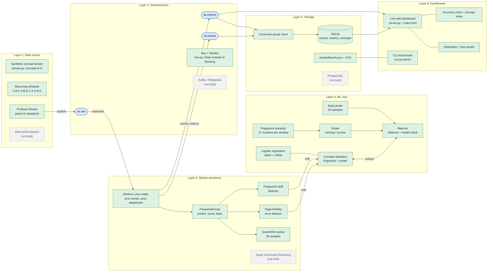
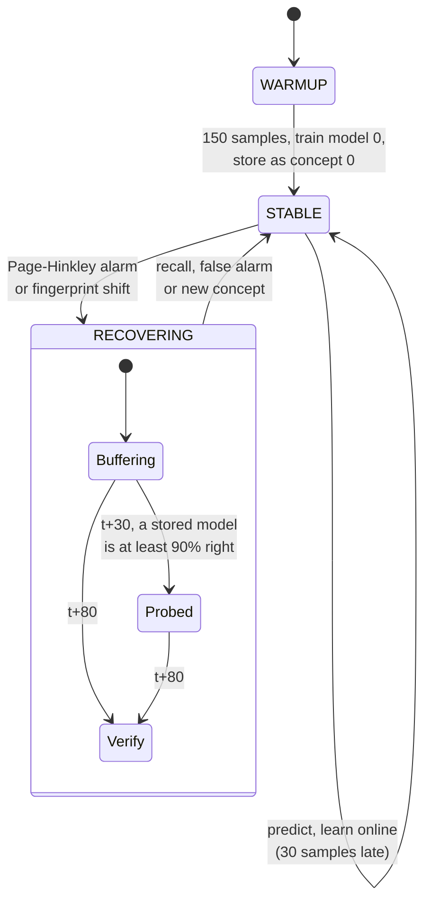
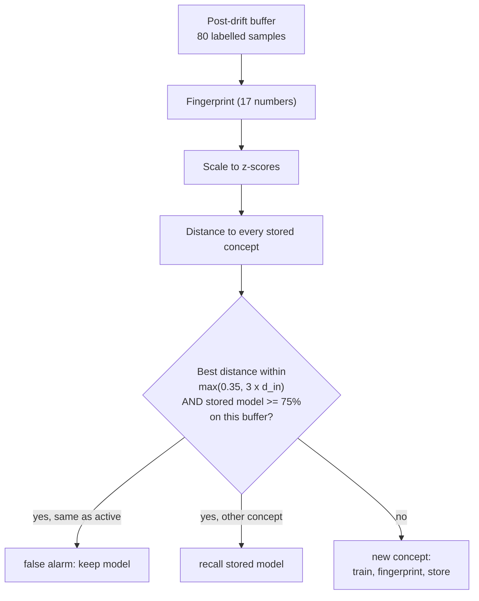
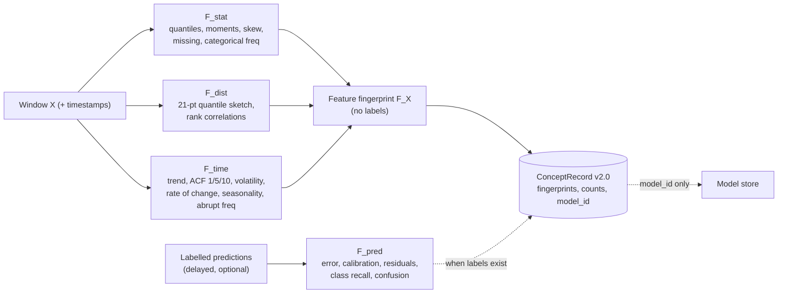
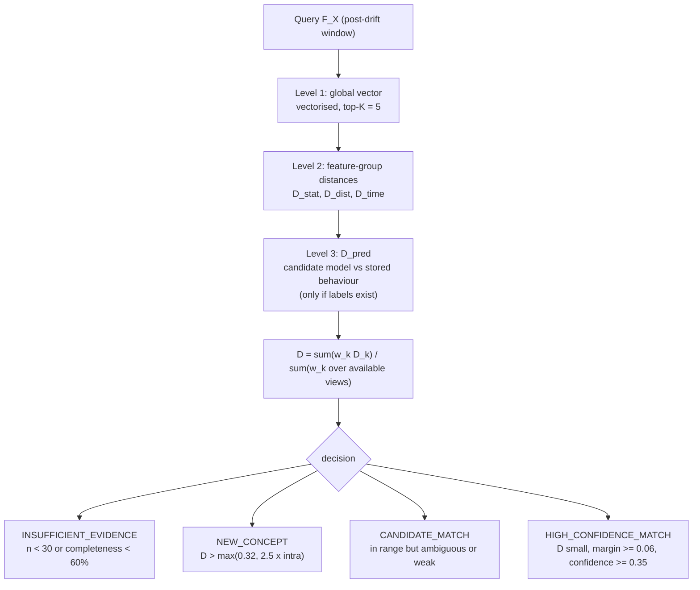
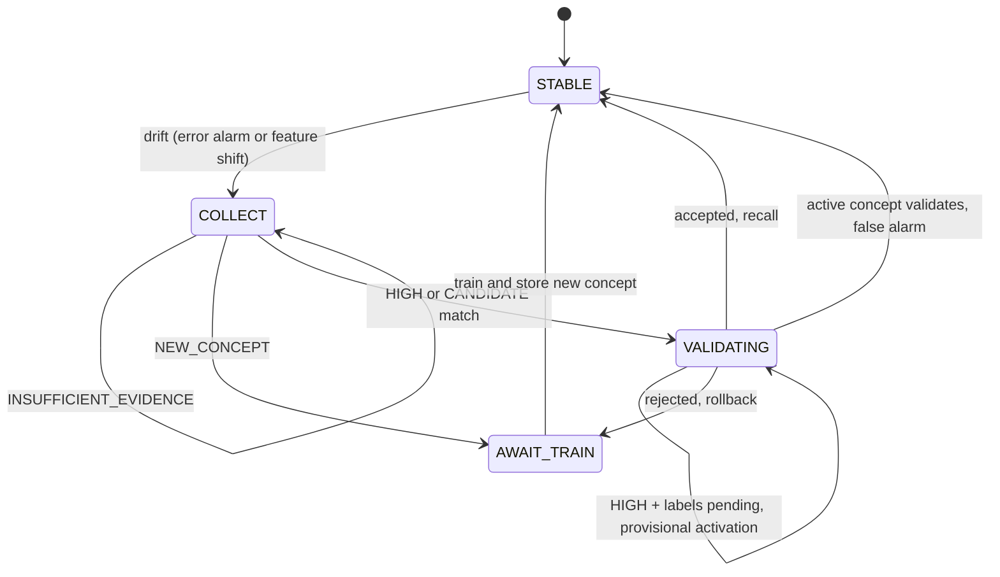

# DejaStream

**Recurrent concept drift detection and model recall in a data stream via concept fingerprinting and pattern matching.**

A data stream sometimes changes the rule it follows (a *concept drift*). Often the old rule comes back: seasons, shifts, customer segments. Most systems retrain from scratch each time. DejaStream keeps a **repository of concepts**. Each concept is stored as a *fingerprint* (a short numeric signature of the data) plus the model trained for it. When drift is detected, the new data is fingerprinted and matched against the repository. A match recalls the old model right away. No match means a genuinely new concept: train a model and store it.

 -3B6FD4) 

---

## Run it

```bash
python3 -m venv .venv && .venv/bin/pip install -r requirements.txt

.venv/bin/python run.py bench                 # offline comparison of all 4 strategies on the demo stream (~1 s)
.venv/bin/python run.py bench-mv              # 8 scenarios x 5 seeds incl. retrieval metrics (~45 s)
.venv/bin/python run.py serve --rate 800      # live pipeline + dashboard at http://127.0.0.1:8000
.venv/bin/python -m unittest discover -s tests   # 185 tests
docs/build.sh                                 # rebuild docs/architecture.pdf from latest numbers
```

`serve` loops the concept schedule forever. Stop it with Ctrl+C.

## Architecture

The system follows six layers. Green is built and verified. Grey dashed is a design-only swap-in for production (see [Built vs. not built](#built-vs-not-built)).



### Publish / subscribe

Publishers never talk to the processor, and the processor never talks to the dashboard. Each side only knows the bus (or the database), so any part can restart or run at a different speed without losing events. Every consumer group keeps its own committed offset per topic. The three strategies therefore read the *same* `ds.raw` log independently, which makes the comparison fair.


| Topic | Carries | Retention |
|---|---|---|
| `ds.raw` | `{t, x, y, concept}` per sample | 100 000 records |
| `ds.events` | `drift`, `probe`, `recall`, `new_concept`, `false_alarm` | 20 000 |
| `ds.metrics` | rolling accuracy every 50 samples plus a repository snapshot | 20 000 |

### What one engine does for each sample



Decision at the end of recovery:



### The fingerprint

A window of labelled samples becomes 17 numbers: per-feature **mean** (4), **std** (4), **class gap** `mean(x|y=1) - mean(x|y=0)` (4), **corr(x, y)** (4) and the **label rate** (1). Means and spreads see changes in `p(x)`. Gaps and correlations see changes in how features relate to the label. Distance is the root-mean-square gap in z-scored space. The z-scoring uses a running per-dimension std, so no single dimension dominates.

### Three strategies on the same stream

| Strategy | Detects drift | On drift |
|---|---|---|
| `static` | no | never adapts (trained once on the first 150 samples) |
| `retrain` | Page-Hinkley on errors | trains a fresh model from 80 buffered samples, keeps no memory |
| `dejastream` (v1) | Page-Hinkley **and** fingerprint shift | probe at 30 samples, verify at 80, recall or train |
| `dejastream_mv` | Page-Hinkley **and** label-free feature shift | multi-view match at 40 samples, shadow validation, provisional activation, rollback ([below](#multi-view-concept-fingerprinting-schema-20)) |

## Multi-view concept fingerprinting (schema 2.0)

`dejastream_mv` is a second recall engine next to the original (`dejastream`, "v1"). v1 is unchanged and kept as the comparison baseline.

### What v1 did (verified in the source)

* Fingerprint: 17 numbers per window = feature mean (4), std (4), class gap `mean(x|y=1)-mean(x|y=0)` (4), `corr(x_i, y)` (4), label rate (1). **Nine of the 17 use the label `y`.**
* The drift check in `engine.py` also fingerprints `(win_X, win_y)`, so even detection needed immediate labels.
* Similarity: RMS z-distance with a running-std scaler. Match if `d <= max(0.35, 3*d_in)` and the stored model scores at least 75% on the buffer. Shift if `d > max(1.6, 4*d_in)`.
* One flat vector, one distance, one yes/no decision. No notion of missing evidence, sample size or confidence.

### What changed

| | v1 | MV (schema 2.0) |
|---|---|---|
| Fingerprint | one 17-d vector | statistics + distributions + temporal (`F_X`, no labels) and predictive (`F_XY`, optional) |
| Labels in identity | yes (9 of 17 numbers) | never: `extract_feature_fp(X, t)` has no `y` parameter |
| Unavailable data | absent from the design | NaN = unavailable, excluded and reported as lower completeness |
| Distance | RMS z-distance | per-view distances in [0,1), noise-floored, weights renormalised over available views |
| Decision | match / no match | `HIGH_CONFIDENCE_MATCH`, `CANDIDATE_MATCH`, `NEW_CONCEPT`, `INSUFFICIENT_EVIDENCE` + confidence score |
| Reuse of a stored model | stored model must score 75% on the buffer | shadow validation, provisional activation, rollback |
| Concept vs model | the same object | separate: records hold `model_id`, models live in a model store |



### Matching: hierarchical, confidence-aware



**Distance.** `D = (w_s D_stat + w_d D_dist + w_t D_time + w_p D_pred) / sum of the weights of the views that exist`, default weights (0.4, 0.3, 0.1, 0.2). Each `D_k = 1 - exp(-max(0, raw - kappa*nu) / tau_k)` lies in [0, 1). `nu = sqrt(1/n_eff_a + 1/n_eff_b)` is the sampling-noise scale, so two windows of the same concept score near 0 whatever their sizes. `n_eff = n(1-rho)/(1+rho)` discounts serial correlation (without it, windows of one AR(0.9) process scored D = 0.41 against each other; with it 0.07). If no view is available `D = 1`, never 0. Similarity is `1 - D` by default; `similarity="exp"` gives `exp(-3D)` (plain `exp(-D)` would squeeze [0,1] into [0.37,1]). `D_dist` uses Wasserstein-1 on the quantile sketches and a PSI computed from them (`dist_metric="wasserstein" | "psi" | "both"`).

**Measured separation** (4-feature test concepts): windows of the same concept score D <= 0.2 even at 40 samples; different concepts score >= 0.486 (smallest observed). Windows of 40 and 300 samples from one concept agree (mean D 0.06). Same mean and std but normal vs uniform: `D_dist` 0.39 vs `D_stat` 0.15.

**Confidence** is a heuristic evidence score, **not a probability**: `closeness x separation from the runner-up x sample-count/completeness x concept variability x (0.85 if no predictive evidence)`. It is deliberately separate from similarity: a 32-sample and a 100-sample window can have similar similarity but very different confidence. Note that with defaults a clean 40-sample match scores about 0.32, just under the 0.35 `HIGH` bar, so it is reported as `CANDIDATE_MATCH`; `HIGH` (and with it provisional activation) needs roughly 50+ samples or a lower `conf_high`.

### Safe model recall



Candidate models (up to 3, **including the currently active concept**) are scored on labelled post-drift samples and compared with the old model. A recall is accepted only if accuracy >= 0.70, >= the old model, at least 30 labelled samples exist, and `D_pred <= 0.6` when a stored predictive fingerprint exists (all in `RecallPolicy`). A `HIGH` match may be served provisionally while labels are still arriving and is rolled back if validation fails. Validating the active concept matters: if data looks like the current concept but errors rose (same X, different Y), only labels can tell, and without this every such drift would be a "false alarm". Matching uses X only and starts immediately; validation waits for released labels (`label_delay`). With no labels at all, nothing is activated or trained.

### Run the multi-view benchmark

```bash
.venv/bin/python run.py bench-mv --seeds 5        # ~45 s, writes results/bench_mv.json and .md
.venv/bin/python run.py bench-mv --seeds 3 --scenarios gradual sea
```

Eight synthetic scenarios (abrupt, noisy, gradual, incremental, similar-X-different-Y, temporal-only, SEA, hyperplane), 5 seeds, mean±std. Retrieval metrics compare engine decisions with the true concept of each sample (definitions in `dejastream/bench_mv.py`). The demo stream (`run.py bench`, one seed):

| strategy | accuracy | first 300 after drift | detected | delay | trained | recalls | false alarms |
|---|---|---|---|---|---|---|---|
| static | 58.7% | 56.4% | 0/10 | n/a | 1 | 0 | 0 |
| retrain | 90.6% | 76.7% | 10/10 | 13.0 | 11 | 0 | 0 |
| DejaStream v1 | 91.8% | 83.2% | 10/10 | 13.5 | 4 | 7 | 2 |
| **DejaStream MV** | 91.6% | 82.4% | 10/10 | 13.5 | 4 | 7 | 1 |

Multi-seed comparison of the two recall engines (full table with all four strategies: [`results/bench_mv.md`](results/bench_mv.md)):

| scenario | engine | accuracy | first 300 after drift | detect delay | models trained | retrieval precision | retrieval recall | false-match |
|---|---|---|---|---|---|---|---|---|
| abrupt, recurring | v1 | 91.5±0.2% | 82.4±0.6% | 17.2±2.4 | 4.0±0.0 | 100.0±0.0% | 100.0±0.0% | 0.0±0.0% |
|  | MV | 91.4±0.2% | 81.9±0.5% | 16.9±2.5 | 4.0±0.0 | 100.0±0.0% | 100.0±0.0% | 0.0±0.0% |
| noisy recurring | v1 | 73.9±0.4% | 65.0±1.2% | 33.4±13.3 | 10.4±3.4 | 96.0±8.0% | 44.7±18.3% | 1.7±3.3% |
|  | MV | 74.3±0.2% | 67.4±0.5% | 29.6±9.1 | 6.6±1.6 | 100.0±0.0% | 73.1±14.9% | 0.0±0.0% |
| gradual drift | v1 | 85.9±0.5% | 72.2±1.2% | 131.7±5.7 | 9.2±1.5 | 100.0±0.0% | 32.5±15.7% | 0.0±0.0% |
|  | MV | 88.4±0.6% | 72.6±1.2% | 110.4±4.0 | 13.0±0.6 | 100.0±0.0% | 40.7±2.8% | 0.0±0.0% |
| incremental drift | v1 | 85.6±0.6% | 74.7±1.3% | 146.1±10.9 | 10.2±2.4 | 76.0±24.8% | 33.5±12.1% | 7.3±6.7% |
|  | MV | 87.8±0.4% | 75.4±1.0% | 121.6±9.1 | 12.4±1.2 | 61.3±5.3% | 46.1±8.1% | 19.6±4.2% |
| similar X, different Y | v1 | 91.1±0.2% | 80.2±0.7% | 12.9±1.6 | 3.0±0.0 | 100.0±0.0% | 100.0±0.0% | 0.0±0.0% |
|  | MV | 90.9±0.2% | 79.1±0.3% | 12.7±1.8 | 3.0±0.0 | 100.0±0.0% | 100.0±0.0% | 0.0±0.0% |
| temporal-only change | v1 | 93.2±0.2% | 93.4±0.5% | 259.2±191.8 | 1.0±0.0 | n/a | n/a | n/a |
|  | MV | 93.1±0.4% | 93.3±0.6% | 322.6±118.2 | 1.6±0.5 | 16.7±23.6% | 100.0±0.0% | 44.4±7.9% |
| SEA | v1 | 85.7±0.3% | 82.5±1.6% | 165.4±83.4 | 2.0±0.0 | 0.0±0.0% | n/a | 10.0±20.0% |
|  | MV | 85.8±0.3% | 82.8±1.4% | 165.1±83.3 | 1.6±0.5 | n/a | n/a | 0.0±0.0% |
| hyperplane | v1 | 89.6±0.2% | n/a | n/a | 1.0±0.0 | n/a | n/a | n/a |
|  | MV | 89.7±0.2% | n/a | n/a | 1.0±0.0 | n/a | n/a | n/a |

### What the results say, and don't

* **Clean abrupt recurrence and similar-X-different-Y:** v1 and MV are equal on retrieval (100% / 100%). MV is *not* better here, and is slightly slower to recover (decision at 40 samples vs v1's probe at 30).
* **Noisy recurring:** MV trains fewer models (6.6 vs 10.4) with higher retrieval recall (73% vs 45%) and a small accuracy gain.
* **Gradual and incremental drift:** MV scores about +2 points accuracy (+2.5 gradual, +2.2 incremental) and detects the drift sooner (label-free shift detector), but trains *more* models, and under incremental drift its retrieval precision is *lower* than v1 (61% vs 76%, false-match 20% vs 7%): windows inside a transition resemble other concepts.
* **SEA:** all concepts share p(x), so feature-only fingerprints cannot separate them. MV falls back to "keep the model if it still validates", which gives the same accuracy as the others.
* **Temporal-only change:** the temporal view separates the two concepts in unit tests, but the engine does not create separate concepts for them: shadow validation shows the existing model still works, so it is resolved as a false alarm. Raising the temporal weight detects the change sooner (129 vs 323 samples) without changing that.
* **Cost:** a fingerprint takes 1.18 ms (100 samples, 4 features) vs 0.037 ms for v1, 3.38 ms at 10 features. The whole engine costs 38 µs per sample vs 12 µs (about 3x). A stored concept takes about 1456 bytes of fingerprint vs 136; models are stored separately and the repository is capped at 50 concepts.
* All data is synthetic. Nothing here shows real-world generalisation.

Two defects were found *by the benchmark and tests* and fixed after observing them (so the numbers above are not from the pre-fix code): the noise floor assumed independent samples, which made autocorrelated data look like constant drift; and an all-missing window looked like a perfect match. A third, a candidate-list bug under gradual drift, crashed the first benchmark run.

### Configuration

| What | Where | Default |
|---|---|---|
| View weights, tau per view, `kappa` (noise floor), distance metric, similarity transform, feature groups | `SimilarityConfig` in `similarity.py` | weights (0.4, 0.3, 0.1, 0.2), `dist_metric="both"`, `similarity="linear"` |
| Thresholds `t_high` / `t_cand`, `k_intra`, `min_samples`, `min_completeness`, `conf_high`, `top_k`, `max_concepts` | `MatchConfig` in `matcher.py` | 0.18 / 0.32, 2.5, 30, 0.6, 0.35, 5, 50 |
| Validation window, accuracy bar, gain over old model, `D_pred` ceiling, shadow count, provisional on/off | `RecallPolicy` in `mv_engine.py` | 30, 0.70, 0.0, 0.6, 3, on |
| Warm-up, window, buffer, labels needed to train, label delay, shift threshold | `MVEngine(...)` | 150, 100, 40, 80, 0, 0.25 |

None of these thresholds is claimed to be universal; they were chosen from the measured within/between-concept gap on the synthetic concepts.

### Status of each part

| Part | Status |
|---|---|
| Feature fingerprint (statistics, distributions, temporal, categorical, missing, constant, outliers), serialisation | implemented and tested (`tests/test_mvfp.py`) |
| Predictive fingerprint, delayed labels, missing labels never read as zero error | implemented and tested |
| Multi-view distance, noise floors, effective sample size, configurable metrics | implemented and tested |
| Hierarchical matcher, four-way decision, confidence score, bounded repository, v1 migration | implemented and tested (`tests/test_matcher.py`) |
| Shadow validation, provisional activation, rollback, delayed labels | implemented and tested (`tests/test_recall.py`) |
| Scenarios, multi-seed benchmark with retrieval metrics, CSV loader | implemented and tested (`tests/test_bench_mv.py`); loader tested on a toy CSV only |
| Dashboard panels (candidate ranking, per-view distances, validation, rollback, concepts) | implemented, checked by eye in a browser; no automated UI test |
| `ConceptRepository.replace_model` (same concept, new model) | implemented and unit-tested, **not used by the engine** |
| Real datasets (Electricity, Airlines) | **not run**: no data bundled or downloaded |
| Categorical features inside the live engine | supported by the fingerprint; the engine's learner (logistic regression) takes numeric input only |
| Calibrated confidence probabilities, learned weights/thresholds, gradual-drift-aware matching | planned, not implemented |

### Known limitations

* Feature-only identification fails when concepts differ only in p(y|x) with identical p(x) (SEA, A vs A'). The engine then relies on shadow validation, which needs labels.
* A drift that the validation call calls a "false alarm" is not fingerprinted as a new concept even if its temporal behaviour differs.
* Windows inside gradual/incremental transitions are mixtures and can be matched to the wrong concept (20% false-match under incremental drift).
* Per-sample cost is about 3x v1; the fingerprint is recomputed every 100 samples while stable and at every recovery.
* The 0.35 `HIGH` confidence bar is not reached by a 40-sample window with defaults, so provisional activation is rare unless `buffer_min` or `conf_high` is changed.
* Windows with an effective sample size below ~30 are noisy; the noise floor compensates on average, not per window.

### Recommended future research

Learn weights and thresholds from held-out streams instead of fixing them; calibrate confidence against observed recall success; transition-aware matching (detect mixture windows and wait); incremental sketches (t-digest) to cut fingerprint cost; evaluate on Electricity, Airlines and other real streams with real delays in labels; a learner that consumes categorical features so the categorical fingerprint is exercised end to end; use `replace_model` when a recognised concept's model degrades.

## Research milestones: uncertainty-aware matching, calibration, validation, memory (M1-M8)

A second, research-style pass tested whether the schema-2.0 matcher could be made statistically sounder and better. Full account: [`docs/RESEARCH.md`](docs/RESEARCH.md) (generated from the raw results in `results/research/`), audit: [`docs/AUDIT.md`](docs/AUDIT.md). All data is synthetic.

**Result in one paragraph.** Schema-2.0 multi-view matching is better than the original v1 fingerprint (significantly higher accuracy in 5 of 18 scenarios, never lower; it survives missing features where v1 collapses). The improvements added afterwards **did not beat schema 2.0**: on fresh seeds (11-20, not used to choose anything) the improved system showed no significant gain on any outcome metric, was significantly less accurate in 3 scenarios and had lower match recall in 2. Individual components are worth keeping for specific reasons; others did not earn their place. The central hypothesis was therefore **supported for schema 2.0 versus v1 and not supported for the later improvements**.

| Question | Verdict | Evidence |
|---|---|---|
| Statistic-specific effective sample size beats the global AR(1) rule | **No** | same-concept q95 0.249 vs 0.210 |
| Empirical same-concept noise profile calibrates better | Yes offline, **not wired into the engine** | false flags 0.1% vs 6.4% |
| Noise correction needed | **Yes** | removing it: false-match 0.5% -> 6.2% |
| Wasserstein and PSI redundant | **No**, complementary | together AUC 0.92; each fails where the other succeeds |
| Standardised temporal statistics, tail term, Fisher-z correlations | Yes | periodicity AUC 0.74 -> 1.00; tail 0.87 -> 0.94 |
| Adaptive top-k keeps the true concept in the shortlist | Yes | candidate recall 0.996 with 5.5 candidates |
| Calibrated view weights | Yes (held out) | top-1 0.865 vs 0.774 |
| Conformal per-concept thresholds | Yes standalone, **hurt in the engine** | match recall 75.6% vs 87.1% without them |
| Heuristic confidence is a probability | **No** | Brier 0.426 vs 0.249 for the base rate; calibrated model 0.199 |
| Predictive validation needed | **Yes** | removing it: first-300 accuracy 78.9% -> 72.0% |
| Paired-CI validation improves outcomes | Controls false accepts (4-5% vs 72-78%); **no accuracy gain** | simulation and streams |
| Mergeable fingerprint memory | Yes (exact std/skew), 2x update cost | merge error 0.01 sigma vs up to 0.72 sigma |
| Recurrence-aware eviction beats least-used | **No** | 64.0 vs 64.0 re-creations; LRU 83.7 |

**How to use it.** Every new option is off by default, so schema 2.0 behaviour is unchanged (a regression freeze and identical benchmark output verify this). The configurations that were evaluated are in `dejastream/research/presets.py` (`improved_similarity`, `improved_match`, `ablation_variants`). `MatchResult.explanation()` returns a structured account of any decision (similarity, evidence quality, confidence score, margin, thresholds, views used and missing, noise status, why alternatives lost, what evidence would help).

**Real data.** ELEC2, Airlines, Intel Berkeley and UCI load diagrams were downloaded (with your approval) and run once each; no variant wins consistently, adaptation *hurts* on Airlines, and the run exposed an eviction bug that no synthetic scenario triggered (fixed). See `docs/RESEARCH.md` section 9. **Not done:** spectral temporal features and a KLL sketch. The empirical noise profile and the calibrated probability are not applied inside the engine.

```bash
.venv/bin/python -m dejastream.research.exp_ablation      # ~9 min, seeds 1-5
.venv/bin/python -m dejastream.research.exp_paired        # ~8 min, seeds 11-20, exact paired tests
.venv/bin/python -m dejastream.research.build_report      # regenerate docs/RESEARCH.md
```

## Measured results (demo stream, one seed)

`python run.py bench`: 16 500 samples, 10 true concept changes, 4 concepts that each recur. Seed 7. Regenerated with every run (`results/bench.json`).

| Strategy | Overall acc. | Acc. in first 300 samples after a drift | Changes detected | Mean delay | Models trained | Recalls | False alarms |
|---|---|---|---|---|---|---|---|
| static | 58.7% | 56.4% | 0/10 | n/a | 1 | 0 | 0 |
| retrain | 90.6% | 76.7% | 10/10 | 13.0 | 11 | 0 | 0 |
| DejaStream v1 | 91.8% | 83.2% | 10/10 | 13.5 | 4 | 7 | 2 |
| **DejaStream MV** | 91.6% | 82.4% | 10/10 | 13.5 | 4 | 7 | 1 |

Both recall engines train exactly one model per concept (4) and recall all 7 revisits. Their gain over retraining is in the recovery window: they switch to a stored, fully trained model instead of waiting for 80 samples and training a weak one. Steady-state accuracy is about the same because both models converge once they have data. MV is marginally *slower* than v1 to recover on this clean stream (it decides at 40 samples, v1 probes at 30). The multi-seed comparison above is the better evidence.

**Caveats.** Synthetic stream, one seed, abrupt drifts. It shows the mechanism works end to end; it does not show the gain transfers to real data. Detection delay is the same for both recall engines here because both rely on the same error detector for these drifts.

## Built vs. not built

| Component | Status |
|---|---|
| Synthetic recurring-concept source, producer thread | built, tested |
| Message bus: topics, offsets, consumer groups, retention, lag, Sender with drop counting | built, tested (in-process) |
| Page-Hinkley and fingerprint-shift detectors, quarantine queue | built, tested |
| v1 fingerprint, scaler, repository, matcher, early probe, logistic-regression learner | built, tested |
| Multi-view fingerprint, hierarchical matcher, safe recall (shadow validation, rollback), scenarios, multi-seed benchmark | built, tested (see [status table](#status-of-each-part)) |
| SQLite storage and the `store` consumer group | built, run live |
| Live web dashboard (accuracy, strips, repository, bus lag, events, multi-view match/validation panels) | built, run live |
| Kafka / Redpanda broker client | **not built**: `bus.py` is an in-process stand-in with the same concepts (topic, group, offset, lag) |
| Spark Structured Streaming processor | **not built**: processor is plain Python threads |
| Real datasets (Electricity, Airlines, ...) | CSV loader built and tested on a toy file; **no real dataset benchmarked** |
| PostgreSQL | **not built**: SQLite instead |

## Repository layout

```
run.py                     entry point (bench | bench-mv | serve)
dejastream/
  stream.py                L1  recurring-concept generator
  bus.py                   L2  topics, offsets, consumer groups, Sender
  pipeline.py              L2-5 wires source, workers, store, dashboard state
  detector.py              L3  Page-Hinkley
  engine.py                L3-4 v1 state machine, repository, matching (static / retrain / dejastream)
  fingerprint.py           L4  v1 fingerprint (17 numbers, uses labels) + scaler
  mvfp.py                  L4  schema 2.0 feature + predictive fingerprints, serialisation, v1 migration
  similarity.py            L4  per-view distances, noise floors, weighted combination
  matcher.py               L4  repository, hierarchical retrieval, decisions, confidence
  mv_engine.py             L3-4 multi-view engine: shadow validation, provisional activation, rollback
  strategies.py            registry: static, retrain, dejastream, dejastream_mv
  scenarios.py, datasets.py  18 synthetic scenarios with ground truth; CSV and sensor-data loaders
  noise.py, validation.py, memory.py  uncertainty models, paired validation, mergeable concept memory (research milestones)
  research/                experiments, ablation, paired tests, scaling, report builder
  models.py                L4  logistic regression
  store.py                 L5  SQLite
  server.py, web/index.html L6 dashboard
  bench.py, bench_mv.py, cli.py  demo benchmark, multi-seed benchmark, CLI
tests/                     185 tests: bus, v1, fingerprints, noise model, distances, retrieval, thresholds, validation, memory, benchmark
docs/architecture.tex      LaTeX/TikZ source for the architecture PDF
docs/architecture.pdf      12 pages: layers, pub/sub, v1 state machine and fingerprint, multi-view fingerprint, matching, safe recall, results, code map
docs/PRESENTATION.md       slide-by-slide talk outline
docs/AUDIT.md, docs/RESEARCH.md  audit of the matcher; research report (tables generated from results/research/)
results/                   bench.json, bench_rolling.csv, bench_mv.json/.md, dejastream.db (generated)
```

## Architecture PDF

[`docs/architecture.pdf`](docs/architecture.pdf) is drawn with LaTeX/TikZ in the same layered style: six layers, publish/subscribe detail, the v1 drift state machine and fingerprint, the multi-view fingerprint, hierarchical matching with confidence, safe recall, the measured accuracy plot, the multi-seed benchmark table and a code map. Its charts and tables are read from `results/bench.json` and `results/bench_mv.json` when you run `docs/build.sh`, so they cannot drift from the code.
