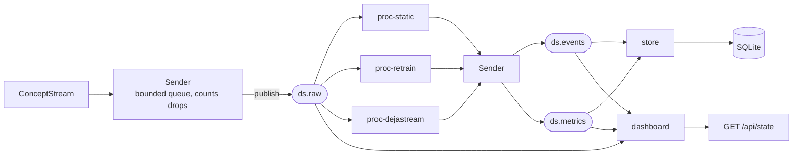
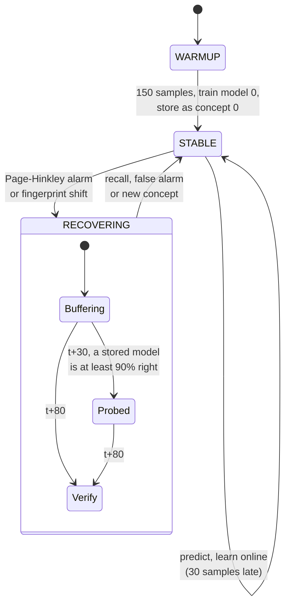
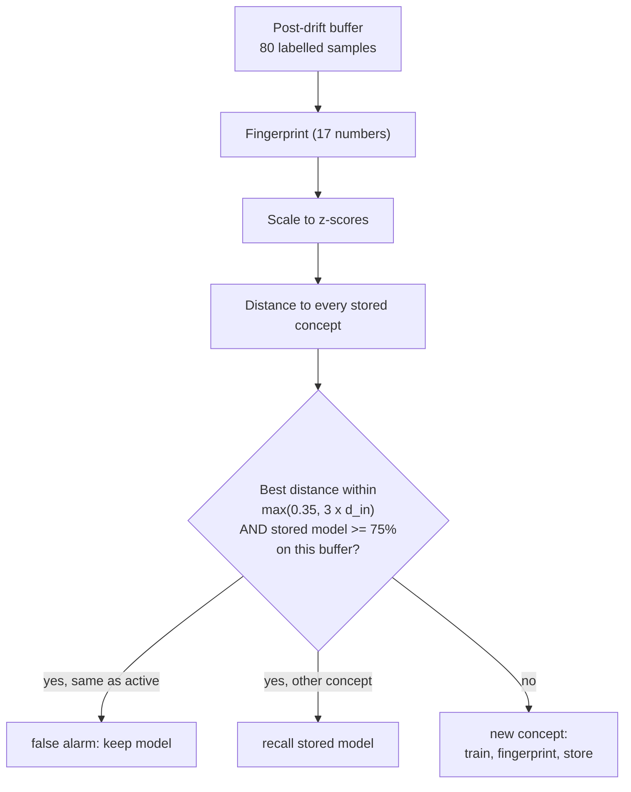

# DejaStream

**Recurrent concept drift detection and model recall in a data stream via concept fingerprinting and pattern matching.**

A data stream sometimes changes the rule it follows (a *concept drift*). Often the old rule comes back: seasons, shifts, customer segments. Most systems retrain from scratch each time. DejaStream keeps a **repository of concepts**. Each concept is stored as a *fingerprint* (a short numeric signature of the data) plus the model trained for it. When drift is detected, the new data is fingerprinted and matched against the repository. A match recalls the old model right away. No match means a genuinely new concept: train a model and store it.

 -3B6FD4) 

---

## Run it

```bash
python3 -m venv .venv && .venv/bin/pip install -r requirements.txt

.venv/bin/python run.py bench                 # offline comparison of the 3 strategies (0.5 s)
.venv/bin/python run.py serve --rate 800      # live pipeline + dashboard at http://127.0.0.1:8000
.venv/bin/python -m unittest discover -s tests   # 5 tests
docs/build.sh                                 # rebuild docs/architecture.pdf from latest numbers
```

`serve` loops the concept schedule forever. Stop it with Ctrl+C.

## Architecture

The system follows six layers. Green is built and verified. Grey dashed is a design-only swap-in for production (see [Built vs. not built](#built-vs-not-built)).


### Publish / subscribe

Publishers never talk to the processor, and the processor never talks to the dashboard. Each side only knows the bus (or the database), so any part can restart or run at a different speed without losing events. Every consumer group keeps its own committed offset per topic. The three strategies therefore read the *same* `ds.raw` log independently, which makes the comparison fair.



| Topic | Carries | Retention |
|---|---|---|
| `ds.raw` | `{t, x, y, concept}` per sample | 100 000 records |
| `ds.events` | `drift`, `probe`, `recall`, `new_concept`, `false_alarm` | 20 000 |
| `ds.metrics` | rolling accuracy every 50 samples plus a repository snapshot | 20 000 |

### What one engine does for each sample



Decision at the end of recovery:



### The fingerprint

A window of labelled samples becomes 17 numbers: per-feature **mean** (4), **std** (4), **class gap** `mean(x|y=1) - mean(x|y=0)` (4), **corr(x, y)** (4) and the **label rate** (1). Means and spreads see changes in `p(x)`. Gaps and correlations see changes in how features relate to the label. Distance is the root-mean-square gap in z-scored space. The z-scoring uses a running per-dimension std, so no single dimension dominates.

### Three strategies on the same stream

| Strategy | Detects drift | On drift |
|---|---|---|
| `static` | no | never adapts (trained once on the first 150 samples) |
| `retrain` | Page-Hinkley on errors | trains a fresh model from 80 buffered samples, keeps no memory |
| `dejastream` | Page-Hinkley **and** fingerprint shift | probe at 30 samples, verify at 80, recall or train |

## Measured results

`python run.py bench`: 16 500 samples, 10 true concept changes, 4 concepts that each recur. Seed 7.

| Strategy | Overall acc. | Acc. in first 300 samples after a drift | Changes detected | Mean delay | Models trained | Recalls | False alarms |
|---|---|---|---|---|---|---|---|
| static | 58.7% | 56.4% | 0/10 | n/a | 1 | 0 | 0 |
| retrain | 90.6% | 76.7% | 10/10 | 13.0 | 11 | 0 | 0 |
| **DejaStream** | **91.8%** | **83.2%** | 10/10 | 13.5 | **4** | 7 | 2 |

DejaStream trains exactly one model per concept (4), and recalls all 7 revisits. Its gain over retraining is in the recovery window: it switches to a stored, fully trained model after 30 samples instead of waiting for 80 and training a weak one. Steady-state accuracy is about the same because both models converge once they have data.

**Caveats.** This is a synthetic stream, one seed, with abrupt drifts. It shows the mechanism works end to end; it does not show the gain transfers to real data. The two false alarms are caught by the matcher (best match is the active concept) at the cost of 80 samples without learning. Detection delay is similar for both strategies because both rely on the same error detector for these drifts.

## Built vs. not built

| Component | Status |
|---|---|
| Synthetic recurring-concept source, producer thread | built, tested |
| Message bus: topics, offsets, consumer groups, retention, lag, Sender with drop counting | built, tested (in-process) |
| Page-Hinkley and fingerprint-shift detectors, quarantine queue | built, tested |
| Fingerprint, scaler, repository, matcher, early probe, logistic-regression learner | built, tested |
| SQLite storage and the `store` consumer group | built, run live |
| Live web dashboard (accuracy, strips, repository, bus lag, events) | built, run live |
| Kafka / Redpanda broker client | **not built**: `bus.py` is an in-process stand-in with the same concepts (topic, group, offset, lag) |
| Spark Structured Streaming processor | **not built**: processor is plain Python threads |
| Real datasets (Electricity, Airlines, ...) | **not built** |
| PostgreSQL | **not built**: SQLite instead |

## Repository layout

```
run.py                     entry point (bench | serve)
dejastream/
  stream.py                L1  recurring-concept generator
  bus.py                   L2  topics, offsets, consumer groups, Sender
  pipeline.py              L2-5 wires source, workers, store, dashboard state
  detector.py              L3  Page-Hinkley
  engine.py                L3-4 state machine, repository, matching, 3 strategies
  fingerprint.py           L4  fingerprint + scaler
  models.py                L4  logistic regression
  store.py                 L5  SQLite
  server.py, web/index.html L6 dashboard
  bench.py, cli.py         offline benchmark + CLI
tests/test_dejastream.py   bus, fingerprint, end-to-end recall
docs/architecture.tex      LaTeX/TikZ source for the architecture PDF
docs/architecture.pdf      6 pages: layers, pub/sub, state machine, fingerprint, results, code map
docs/PRESENTATION.md       slide-by-slide talk outline
results/                   bench.json, bench_rolling.csv, dejastream.db (generated)
```

## Architecture PDF

[`docs/architecture.pdf`](docs/architecture.pdf) is drawn with LaTeX/TikZ in the same layered style: six layers, publish/subscribe detail, the drift state machine, fingerprint matching, the measured accuracy plot and a code map. Its results chart and table are read from `results/bench.json` when you run `docs/build.sh`, so they cannot drift from the code.
