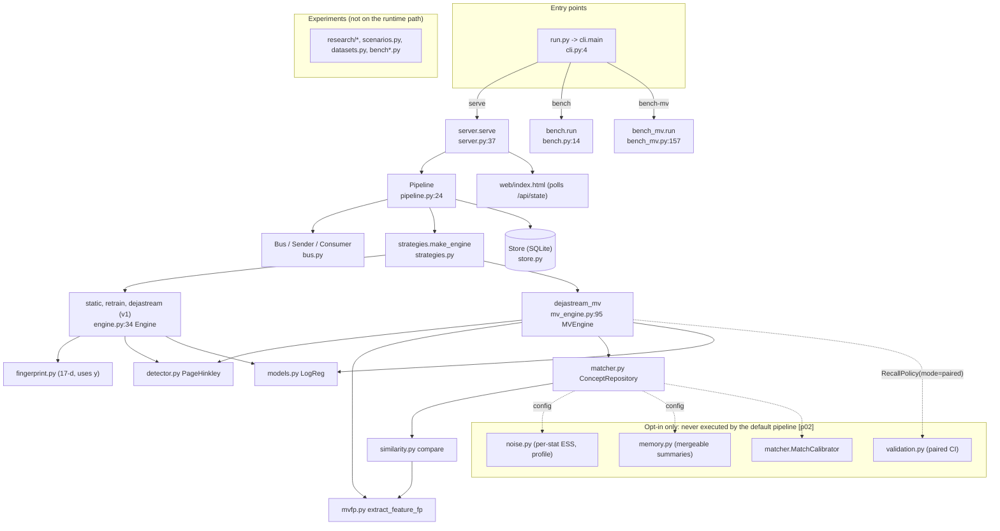
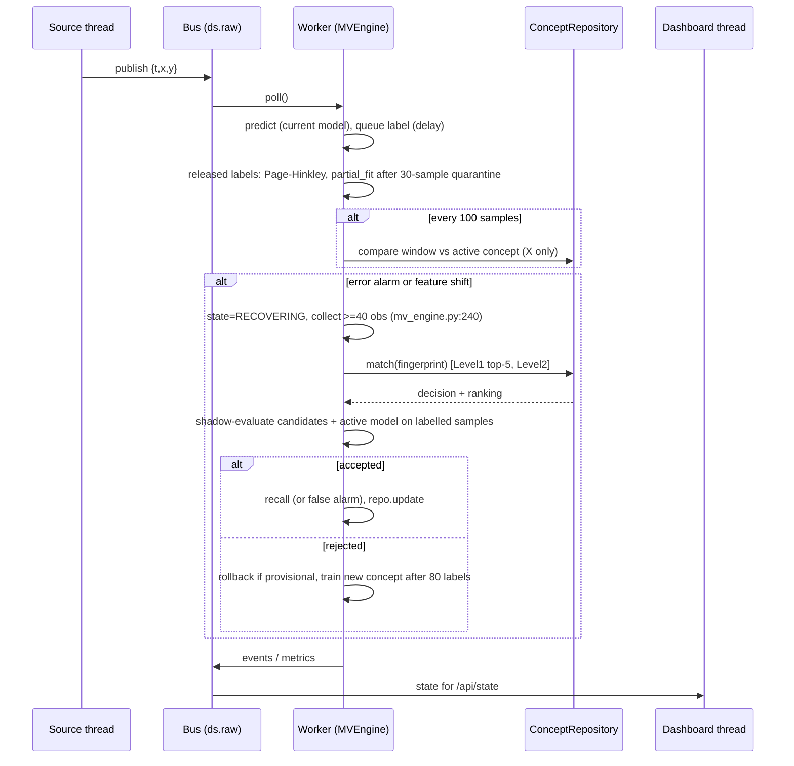

# DejaStream: repository audit and technical review

**Audited:** working tree of `/run/media/heytanix/Shared/final_year_project`, branch `research-matching`, base commit `117e95a`, plus uncommitted edits to `cli.py`, `datasets.py`, `pipeline.py`, `server.py`, `web/index.html`, `tests/test_bench_mv.py` (the real-data stream source and the tabbed dashboard). Local `origin/main` carries only the first commit.
**Date:** 2026-11-23. **Mode:** audit only. No file under `dejastream/`, `tests/`, `docs/` or `results/` was modified by the audit (verified: no file in those trees is newer than the first probe; the only tracked `results/` change, `bench.json` wall-clock `seconds` 1.64 to 1.63, dates from 15:55, before the audit began at 16:44). Everything the audit created is in `audit/` (`probes/` = scripts, `evidence/` = their raw output, this report).

**Evidence classes used below.** *[src]* read from source with `file:line`. *[run]* executed in this audit, output in `audit/evidence/pNN_*.txt`. *[stored]* a result file produced by earlier work and **not** re-run here. *[doc]* a claim from README/docs. Anything not marked is inference and is said to be so.

**A conflict of interest the reader should know about.** Most of this code was written in earlier sessions by the same assistant that wrote this audit. To compensate, every finding below rests on an executed probe or a cited line, the test suite was mutation-tested, and findings that make the author's earlier work look bad are reported as found.

---

## 1. Executive Summary

DejaStream is a working research prototype: the default live pipeline runs end to end (16,499 samples through four strategies in 10 s *[run p02]*), 186 tests pass *[run p03]*, and the headline benchmarks reproduce exactly *[run p08]*. It is not production software, and parts of the "safe recall" story are weaker than the documentation suggests.

| Dimension | Assessment | Basis |
|---|---|---|
| Overall health | **Prototype that runs; fragile at its edges** | 186/186 tests pass, but the live system has 0% test coverage and fails silently *[p03, p04]* |
| Architecture maturity | Moderate | Clear layers (bus, engine, matcher, store, UI); two engine generations coexist; the new capabilities are mostly opt-in and never run in the default pipeline *[p02]* |
| Algorithm maturity | Moderate for schema-2.0 matching; low for the later "improvements" | Schema 2.0 beats v1 in 5 of 18 scenarios and never loses *[stored RESEARCH.md]*; the improvement bundle did not beat it |
| Statistical reliability | **Mixed** | Defaults contain confirmed statistical defects (wrong merge, single global rho, uncalibrated confidence, Level-1 recall collapse with look-alikes) *[p05, stored audit.json]* |
| Engineering reliability | **Low** | Recovery can stall forever with unbounded buffers; a worker exception kills a thread silently; no persistence of learned concepts or models; no logging, CI or packaging *[p04, grep]* |
| Research readiness | Prototype, not publishable as is | Synthetic only plus four single real-data runs; no established-detector or kNN baseline; the confirmatory test was honest and negative for the improvements |

**Confidence in this audit.** High for what was executed (tests, coverage, mutation sampling, 8 probes, reproduction of two benchmarks and the audit measurements). Medium for the dashboard (inspected, not tested) and for stored experiment results I did not re-run (E1 to E14 in `results/research/`, except `audit.json`, which reproduced bit-for-bit). Not assessed: Python 3.14-specific behaviour beyond what ran, true concurrency stress, security beyond source reading.

**The three most important facts.**
1. If labels stop arriving, the multi-view engine enters recovery and never leaves; its buffers grow without bound (11,908 entries after 16,500 samples) and it serves a stale model forever *[p04-A]*.
2. In the default configuration the stored concept fingerprints are corrupted by the merge rule (stored std 0.999 vs true 2.36) *[p05-7]*, and the Level-1 shortlist of five misses the true concept more than half the time when concepts share marginals (Recall@5 = 0.57 with 12, 0.33 with 24) *[p05-4]*.
3. The tests cannot detect a broken rollback: replacing the rollback's model restore with `pass` leaves all 186 tests green *[p06-M06]*.

---

## 2. Architecture Map

### 2.1 Repository structure and the code that actually runs



**Two implementations are live side by side.** `engine.py` (v1: `Engine`, strategies `static`, `retrain`, `dejastream`) and `mv_engine.py` (`MVEngine`, strategy `dejastream_mv`) are both instantiated by the default pipeline (`pipeline.py:34`, `strategies.py`). v1 is kept as a baseline; nothing is marked deprecated. There is no third "experimental" engine; the experimental surface is configuration (`SimilarityConfig`, `MatchConfig`, `RecallPolicy`) and `research/`.

### 2.2 Module responsibilities

| Module | Responsibility / public interface | Depends on | Called by | Status |
|---|---|---|---|---|
| `cli.py` | argparse commands `bench`, `bench-mv`, `serve` | bench, bench_mv, server | `run.py` | production-facing, **0% tested** |
| `server.py` | stdlib HTTP server, `/` and `/api/state`, binds 127.0.0.1 (`server.py:37-54`) | pipeline, datasets | cli | demo-facing, 0% tested |
| `pipeline.py` | Threads: source, one worker per strategy, store, dashboard state (`pipeline.py:54-166`) | bus, strategies, store, scenarios | server | demo-facing, 0% tested |
| `bus.py` | In-process topics, offsets, consumer groups, `Sender` (`bus.py:17-132`) | stdlib | pipeline | prototype stand-in for Kafka; 93% covered |
| `store.py` | SQLite tables `events`, `metrics`, `concepts` (v1 snapshot only) (`store.py:10-44`) | sqlite3 | pipeline | demo; 0% tested |
| `engine.py` | v1 engines (`Engine.process`) | fingerprint, detector, models | strategies | baseline, active |
| `fingerprint.py` | v1 17-number fingerprint, uses `y` (`fingerprint.py:21-29`) | numpy | engine | baseline, active |
| `mv_engine.py` | `MVEngine.process`, drift to recovery to match to validation (`mv_engine.py:169-415`) | mvfp, matcher, validation, detector, models | strategies | primary, active |
| `matcher.py` | `ConceptRepository`: Level 1, Level 2, decisions, thresholds, eviction (`matcher.py:340-640`) | similarity, mvfp, memory | mv_engine | primary, active |
| `similarity.py` | `compare()` and per-view distances (`similarity.py:223-448`) | mvfp, noise | matcher | primary, active |
| `mvfp.py` | `extract_feature_fp`, predictive fingerprint, v1 migration (`mvfp.py:222`, `:359`, `:461`) | numpy | engine, matcher | primary, active |
| `noise.py`, `memory.py`, `validation.py` | ESS models, mergeable memory, paired validation | numpy | matcher / engine **only when configured** | **implemented, not on the default path** [p02] |
| `detector.py` | Page-Hinkley (`detector.py:6-18`) | none | both engines | active |
| `scenarios.py`, `datasets.py`, `bench*.py`, `research/` | streams, loaders, benchmarks, experiments | | cli, tests | experimental tooling |

### 2.3 What the default `serve` path actually executes *[run p02]*

`Pipeline()` with default engines ran 16,499 samples. Definitions **never executed** by it include all of `noise.py`, all of `memory.py`, all of `validation.py` (except a few constructors), `ConceptRepository.to_dict/load_dict`, `observe_same`, `conformal_quantile`, `_evict` (50 concepts were never reached), `FeatureFingerprint.l1_unit`, `PredictiveAccumulator.reveal`, `migrate_v1`. In other words the research milestones are reachable only through non-default configuration.

### 2.4 Execution trace of one observation (Phase 2)

| # | Step | Function (file:line) |
|---|---|---|
| 1 | Source produces and publishes | `Pipeline._produce` `pipeline.py:69-85`; `Sender.send` `bus.py:112-121` |
| 2 | Worker consumes | `Pipeline._process` `pipeline.py:87-95` (`cons.poll`, then `eng.process`) |
| 3 | Preprocessing | none in the engine; `LogReg` standardises with training mean/sd and imputes NaN to the mean (`models.py`, `fit`/`predict`) |
| 4 | Prediction | `MVEngine.process` `mv_engine.py:169-177` |
| 5 | Label arrival | delay queue released by *sample-time difference* `mv_engine.py:178-183` (not by sample id; `PredictiveAccumulator.reveal` `mvfp.py:429` exists but is unused by the engine) |
| 6 | Error monitoring | `PageHinkley.update` on released errors `mv_engine.py:208-213`, `detector.py:12-18` |
| 7 | Feature-shift monitoring | every `window` samples, `d.combined > shift_threshold` (0.25) `mv_engine.py:216-221` |
| 8 | Drift to recovery | `_Recovery(...)` created and `state = "RECOVERING"` `mv_engine.py:229-236` |
| 9 | Buffer collection | `r.X/r.t/r.lab` appended without bound `mv_engine.py:240-242` |
| 10 | Fingerprint | `_fp` `mv_engine.py:136`, `extract_feature_fp` `mvfp.py:222` (labels not an input) |
| 11 | Candidate retrieval | `ConceptRepository.level1` `matcher.py:517`, index `:488` |
| 12 | Multi-view similarity | `ConceptRepository.score` to `similarity.compare` `similarity.py:398` |
| 13 | Decision | `ConceptRepository.match` `matcher.py:548-640` (INSUFFICIENT `:554`, NEW `:606`, HIGH `:608`, else CANDIDATE) |
| 14 | Candidate validation | `_try_match` `mv_engine.py:258-294`, `_feed :295`, `_resolve :304-326` (legacy), `_resolve_paired :328` (opt-in) |
| 15 | Recall or new model | `_finish` `mv_engine.py:376-404`, `_train_new :405-415` |
| 16 | Repository update | `ConceptRepository.update` `matcher.py:389-415`, `add :340` |
| 17 | Persistence | **none for the multi-view repository or any model**; `pipeline.py:119` to `store.save_concepts` stores only v1 z-vectors |
| 18 | Monitoring/logging | `_ev` event dicts `mv_engine.py:152`, bus topics, dashboard; **no `logging` use anywhere** *[grep]* |



### 2.5 Answers to the Phase 2 questions

* **Connected end to end?** Yes for the default configuration *[p02]*. The opt-in machinery is connected only if configured.
* **Implemented but never invoked (default)?** See 2.3. Also `RecallPolicy.mode="none"` and `"paired"` are reachable only by explicit policy.
* **Paths that bypass safety checks.** (a) `mode="none"` skips validation entirely (`mv_engine.py:309-312`, ablation only, labelled unsafe). (b) A `HIGH_CONFIDENCE_MATCH` candidate **serves predictions before it is validated** (`mv_engine.py:285-290`), for as long as labels take to arrive; with labels delayed 200 samples the measured post-drift accuracy was 49.6% (v1-style recovery 72.6% at delay 50) *[stored e11]*.
* **Can an observation be processed twice?** Yes. No sequence number or de-duplication: replaying 50 seen observations was accepted, `detector.n` rose to 200 *[p04-D]*.
* **Out of order?** Labels are released by `t - t_oldest >= label_delay` (`mv_engine.py:180`). With decreasing timestamps and `label_delay=5`, **no label is ever released**: warm-up never ends and the delay queue grows without bound (400 entries after 400 samples) *[p04-C]*.
* **Labels delayed indefinitely / missing?** Warm-up never finishes if `label_delay` exceeds the stream (state `WARMUP`, constant prediction 0, `_wu_X` grows) *[p04-B]*. After a drift, with labels gone, the engine stays in `RECOVERING` forever *[p04-A]*.
* **Repeated drift?** No cooldown or hysteresis; `_resume` just resets the detector (`mv_engine.py:158-167`). On a stationary single-concept stream the measured false drift rate was about 0.6 per 10,000 samples, all from the error detector *[p04-E]*; on ELEC2 the multi-view engine raised 279 drifts in 45,312 samples *[stored e14]* (no ground truth, so not classifiable).
* **Exception during recovery?** There is no `try/except` in `Pipeline._process` (`pipeline.py:87-107`). Injecting a fault in `match()` killed that worker thread; the other threads kept running, `proc-dejastream_mv` lag grew to 13,425, the traceback went only to stderr, and `/api/state` kept reporting the stale accuracy with no alert *[p04-F]*.
* **Stuck in recovery?** Yes (A). Stage `validating` or `await_train` has no timeout (`mv_engine.py:250`, `:268-276`, `:304-308`).

---

## 3. Feature Implementation Matrix

| Feature | Expected behaviour | Actual implementation | Status | Evidence |
|---|---|---|---|---|
| Live pipeline | Stream, process, display | Threads over an in-process bus; runs | IMPLEMENTED | p02; 0% tested (p03) |
| Prequential prediction + delayed learning | Predict before learning, no leakage | 30-sample quarantine before online updates | IMPLEMENTED | `mv_engine.py:208-212`; mutant M09 killed |
| Label delay | Labels arrive late | Delay by sample-time, not by id; no mechanism for missing labels | PARTIALLY IMPLEMENTED | `mv_engine.py:178-183`; p04-A/B/C |
| Error-based drift detection | Detect accuracy change | Page-Hinkley, fixed parameters, not exposed by `MVEngine` | IMPLEMENTED | `mv_engine.py:109`, `detector.py:7`; FP rate 0.6/10k (p04-E) |
| Label-free drift detection | X-only shift | Window-vs-concept distance > 0.25 every 100 samples | IMPLEMENTED | `mv_engine.py:216-221` |
| Drift vs recurrence separation | Detect first, then identify | Separate stages, but the shift test uses the same noisy distance as matching | PARTIALLY IMPLEMENTED | `mv_engine.py:216-221` |
| Recovery state machine | Always terminates | No timeout; unbounded buffers | PARTIALLY IMPLEMENTED (stalls) | p04-A |
| Statistical view | Moments, quantiles, skew, missing, categorical | Present; distance uses robust subset by default | IMPLEMENTED | `mvfp.py:222`, `similarity.py:223` |
| Distribution view | Quantile sketch, W1, PSI, correlations | Present; W1 and PSI overlap partly (rank corr 0.63) | IMPLEMENTED | `similarity.py:270-335`; stored e2 |
| Temporal view | Normalised, timestamp-aware | Default distance is a mean of heterogeneous absolute differences; standardised version opt-in; weight 0.10 | PARTIALLY IMPLEMENTED | `similarity.py:339-346`, `:34`; p05-2 |
| Predictive view | Label-aware, optional | Built from stable windows only; used only if a stored predictive fingerprint exists | PARTIALLY IMPLEMENTED | `mv_engine.py:225-229`, `matcher.score` |
| Feature-only fingerprint (no label leakage) | No `y` input | `extract_feature_fp(X, t)` has no `y` | IMPLEMENTED | `mvfp.py:222`; v1 does use `y` `fingerprint.py:21-29` |
| Default fingerprint merge | Statistically valid update | Entry-wise weighted averaging | **BROKEN** | `matcher.py:408` to `mvfp.py:303`; p05-7 |
| Mergeable summaries | Exact moments, sketch | Implemented, opt-in | PARTIALLY IMPLEMENTED (not default) | `memory.py`; p02 |
| Effective sample size | Correct per statistic | Global median rho, clipped at 0 | PARTIALLY IMPLEMENTED | `mvfp.py:85`; p05-1 |
| Noise floor | Calibrated to same-concept noise | Analytic `kappa*nu`; empirical profile exists but is not wired to the engine | PARTIALLY IMPLEMENTED | `similarity.py:204`, `noise.py`; stored e1 |
| Level-1 retrieval | Keep the true concept in the shortlist | Median/sigma/q10/q90 vector, top 5 | PARTIALLY IMPLEMENTED (recall collapses) | `matcher.py:38`, `:488-530`; p05-4 |
| Level-2 multi-view distance | Bounded, interpretable | Bounded in [0,1]; weights renormalise over available views | IMPLEMENTED | `similarity.py:398-448` |
| Decision categories | Four outcomes, correct order | Verified | IMPLEMENTED | `matcher.py:554-611` |
| Confidence | Calibrated | Heuristic product; contains similarity; Brier 0.426 vs 0.249 base rate | IMPLEMENTED as uncalibrated heuristic | `matcher.py:592-599`; stored e8 |
| Calibrated probability | Reliable | Logistic calibrator exists, offline only | PARTIALLY IMPLEMENTED | `matcher.py:223`; p02 |
| Shadow validation | Test candidates without serving | Candidates + active model scored on labelled samples | IMPLEMENTED | `mv_engine.py:295-326` |
| Statistically sound validation | CI, task-aware, selection-bias control | `validation.py`, opt-in, classification only in engine | PARTIALLY IMPLEMENTED | `mv_engine.py:43-49`; p02 |
| Provisional activation | Serve before validated | Only for HIGH matches | IMPLEMENTED | `mv_engine.py:285-290` |
| Rollback | Restore prior model state | Resets `self.model` to the previous object | IMPLEMENTED, **UNVERIFIED by tests** | `mv_engine.py:395-399`; p06-M06 survived |
| In-memory repository | Bounded, no dangling ids | Cap 50; eviction bug fixed | IMPLEMENTED | `matcher.py:340-387` |
| Repository + model persistence | Survive restart | Fingerprint `to_dict` exists; **nothing calls it; models have no loader** | **NOT IMPLEMENTED** | p02; `models.py:48`; `store.py:13-15` |
| Established-detector baseline | ADWIN/DDM etc. | Absent (Page-Hinkley only) | NOT IMPLEMENTED | grep |
| kNN-fingerprint baseline | Nearest-neighbour | Absent (v1 is a distance-threshold matcher, not a separate kNN baseline) | NOT IMPLEMENTED | grep |
| Real-dataset benchmarks | Chronological, multiple seeds | ELEC2, Airlines, Intel, UCI run once each; derived labels for two | PARTIALLY IMPLEMENTED | stored e14 |
| Regression/anomaly models in engine | Task-agnostic recall | Learner is a logistic classifier | NOT IMPLEMENTED | `mv_engine.py:43-49` |
| Missing features at runtime | Handle gracefully | MV imputes; v1 breaks on NaN | IMPLEMENTED (MV), BROKEN (v1) | stored e11 feature_availability |
| Logging, CI, packaging | Standard engineering | None | NOT IMPLEMENTED | grep; no `.github`, no `pyproject` |
| Thread safety | No shared-state races | One thread per engine; snapshots under lock; death not detected | PARTIALLY IMPLEMENTED | `pipeline.py:37`, p04-F |

---

## 4. Critical Findings

Reproduce any probe with `cd` to the project root and `.venv/bin/python audit/probes/pNN_*.py`. All counterexamples use the **default** configuration unless stated.

### P0: critical correctness or safety failures

**F-01 Recovery can stall forever and leak memory.**
* *Where:* `mv_engine.py:240-242` (buffers appended every sample), `:250`, `:268-276`, `:304-308` (no exit when labels never come); also `:116-125` warm-up.
* *Behaviour:* After drift, `_recovering` appends every observation to `r.X`, `r.t`, `r.lab`. Matching can finish, but validation needs `val_min` released labels and training needs `train_min`; without labels neither happens and no timeout, size cap or fallback exists.
* *Reproduction:* `p04-A`: labels dropped after t=3200; at t=16,500 `state=RECOVERING`, `len(rec.X)=11,908`. `p04-B`: `label_delay=10**9` leaves the engine in `WARMUP` with a constant prediction.
* *Impact:* silent permanent use of a stale model; linear memory growth proportional to stream length.
* *Fix:* bounded recovery (max duration and buffer size), a defined fallback (resume the previous model, or train on whatever labels exist, and raise a health event), and a hard cap on `_wu_X`.
* *Test:* an engine run with labels removed after a drift must reach a terminal state within N samples and keep `len(rec.X)` below the cap.

**F-02 A worker exception is swallowed silently and the dashboard goes stale.**
* *Where:* `pipeline.py:87-107` (no `try/except`), `_spawn` `pipeline.py:60-63` (daemon threads, no supervision).
* *Behaviour:* an exception ends the thread; nothing restarts it or reports it.
* *Reproduction:* `p04-F`: a fault injected into `ConceptRepository.match` (in memory) killed `proc-dejastream_mv`; lag reached 13,425; `/api/state` still reported `acc=0.899, seen=3050`.
* *Impact:* a failed engine looks healthy. Unacceptable for deployment; misleading in a demo.
* *Fix:* catch and log per observation or restart the worker with backoff; add a heartbeat and `state: "failed"` to the API.
* *Test:* a pipeline test with an injected exception must produce a failed-state flag within a bounded time.

### P1: major algorithmic or engineering weaknesses

**F-03 Default fingerprint merge produces wrong statistics.**
* *Where:* `matcher.py:408` (`merge_feature_fp`), `mvfp.py:303-335`.
* *Behaviour:* entry-wise weighted averaging of std, quantiles, correlations and temporal statistics.
* *Counterexample [run p05-7]:* merging N(0,1) (n=300) with N(5,1) (n=100) stores std 0.999 and q90 2.40; the pooled values are 2.36 and about 5.2. Two same-concept windows whose location differs are the realistic trigger.
* *Impact:* the concept memory drifts away from the data it summarises. The correct implementation exists (`memory.py`) but is off by default.
* *Fix:* make `merge_mode="mergeable"` the default after the cost is accepted (update about 2x), or at least stop averaging std and quantiles.
* *Test:* assert pooled std and quantiles within tolerance after merging windows with different means (exists for the opt-in path in `tests/test_memory.py`; none for the default path).

**F-04 Level 1 loses the true concept when concepts share marginals.**
* *Where:* `matcher.py:38` (`top_k=5`), `:488-530`, `:47-54` (fallback `expand_on_new` default False).
* *Counterexample [run p05-4]:* concepts with identical marginals but different dependence/temporal behaviour: Level-1 Recall@1/3/5/10 = 0.28/0.59/0.78/1.00 (6 concepts), 0.15/0.38/0.57/0.86 (12), 0.09/0.25/0.33/0.53 (24). A true concept ranked sixth is never scored by Level 2.
* *Impact:* recurring concepts are reported as new, causing retraining; the loss grows with repository size.
* *Fix:* measure first (see 13, Stage 3). Opt-in adaptive top-k reached candidate recall 0.996 on a different library *[stored e4]*.
* *Test:* a retrieval-recall regression test on a look-alike library with a recall floor.

**F-05 The learned concept memory is not persisted, and the database is wiped on start.**
* *Where:* `store.py:13-15` (`fresh=True` drops all tables), `pipeline.py:119` (saves only the v1 snapshot), `matcher.py:622-635` (`to_dict`/`load_dict` never called by production code), `models.py:48` (`LogReg.to_dict`, no `from_dict`).
* *Impact:* a "recurrent concept" system forgets every concept at restart; models are never serialisable.
* *Fix:* persist repository + models with versioning; do not drop tables by default.
* *Test:* restart round trip: after save/load the engine must recall a concept without retraining.

**F-06 Rollback is unverified by any test, and models are aliased.**
* *Where:* `mv_engine.py:395-399` (rollback), `:149`, `:390` (stored model object becomes the live model; `partial_fit` in `_stable` mutates it in place).
* *Evidence:* mutant M06 (rollback does not restore the model) and M07 (false-alarm path disabled) both **survive** 186 passing tests *[p06]*. `p04-H`: the active model *is* the stored object.
* *Impact:* a regression in the one safety mechanism the project advertises would go unnoticed; the version of a model that was validated is not preserved once it learns online.
* *Fix:* assert in a test that `engine.model is prev_model` and unchanged weights after a rejected provisional recall; consider snapshotting a model before it is recalled.
* *Test:* provisional recall with a deliberately failing candidate; assert model identity and a weights digest.

**F-07 Drift detection has fixed parameters, no cooldown, and a measurable false-alarm rate.**
* *Where:* `mv_engine.py:109` (`PageHinkley()` defaults `delta=0.02, lam=9, min_n=30` from `detector.py:7`), `:158-167` (`_resume`).
* *Evidence:* 0.6 false drifts per 10,000 samples on a stationary stream *[p04-E]*; detection delay is 17 samples on abrupt drift but about 110 to 120 on gradual and incremental drift *[stored e11]*.
* *Fix:* expose detector parameters; add a refractory period; measure false drift per stream length in the benchmark.
* *Test:* a stationary-stream test with an allowed false-drift budget.

**F-08 Validation uses a fixed absolute accuracy bar and reuses the selection samples.**
* *Where:* `mv_engine.py:34` (`min_acc=0.70`), `:319-325` (best candidate chosen on the same samples whose accuracy is then logged as `val_acc` at `:393`).
* *Evidence:* with three equally good models selected on 30 samples the selected model scores +0.060 above its true accuracy *[run: reproduced as part of audit.json, p08-R3]*. Accuracy is blind to class imbalance: with an 8% positive class a constant "negative" model scores 0.92 and passes both `acc >= 0.70` and `acc >= baseline`.
* *Impact:* optimistic reported recall quality; imbalanced and non-classification tasks are not covered.
* *Fix:* the opt-in `validation.py` addresses it; the experiments showed it controls false accepts (4-5% vs 72-78%) but did not improve accuracy on the streams, so the right decision is task-dependent.

**F-09 Missing evidence can lower the distance, and the temporal view cannot veto a match.**
* *Where:* `similarity.py:432-440`, default weights `similarity.py:34`.
* *Counterexample [run p05-2]:* an iid window vs an AR(0.9) window with the same marginals has `D_time = 0.385` but combined D = 0.048 (HIGH_CONFIDENCE range); with the temporal view unavailable D = 0.000. Weight renormalisation `D = (0.4 Ds + 0.3 Dd + 0.1 Dt)/0.8` versus `(0.4 Ds + 0.3 Dd)/0.7` shows the mechanism. With `weight_mode="fixed"` (opt-in) the same short windows give D = 0.499.
* *Impact:* concepts that differ only temporally are matched as the same concept.

**F-10 One global rho drives every noise floor.**
* *Where:* `mvfp.py:85` (`effective_n`), `similarity.py:204`.
* *Counterexample [run p05-1]:* features with lag-1 ACF [0.84, 0.87, 0.01, 0.02]; the median 0.43 gives `n_eff = 79.9` of 200, while the autocorrelated features have a mean-type `n_eff` of about 13-17. Negative rho is clipped to 0 (ACF about -0.8 gives `n_eff = 200`).
* *Impact:* floors are wrong in both directions for heterogeneous features. The "per-statistic" alternative did not improve matching in experiments, so this is a documented weakness rather than an obvious fix.

**F-11 A single stored concept yields HIGH_CONFIDENCE_MATCH for substantial shifts.**
* *Where:* `matcher.py:588-593` (`second = 1.0` when there is one candidate), `:608`.
* *Counterexample [run p05-3]:* with one stored concept, queries shifted 0.25 sigma on all four features gave HIGH in 30/30 cases (mean D 0.113); 0.35 sigma gave HIGH in 16/30.
* *Impact:* the separation criterion is vacuous with one concept; only shadow validation protects the pipeline.

**F-12 The fingerprint carries no feature schema.**
* *Where:* `similarity.py:408` checks index layout only; `matcher.py:494` returns no candidates on a layout mismatch.
* *Counterexamples [run p05-5]:* the same concept with two columns swapped scores D = 0.449 (vs 0.085) with no error; a query with an extra fifth feature is silently reported `NEW_CONCEPT` ("no compatible stored concept").
* *Fix:* store feature names or a schema hash and fail loudly on mismatch.

### P2: important reliability or performance issues

**F-13 Models of evicted concepts are never released.** `mv_engine.py:149` adds to `self.models`; nothing deletes (`grep "del self.models"` empty). With a cap of 2 the engine held 11 models for 2 concepts *[p04-G]*.
**F-14 No de-duplication or ordering checks.** `mv_engine.py:169-183` accepts replays and out-of-order timestamps (p04-C/D).
**F-15 The live system is untested.** Statement coverage of `pipeline.py`, `store.py`, `server.py`, `cli.py` is 0% *[p03]*; mutant M13 (pipeline counts every sample as correct) survives.
**F-16 Some tests assert nothing.** `tests/test_recall.py:81` compares `e.state` with itself (`"RECOVERING" if e.rec else e.state`); `tests/test_validation.py:48` compares a function's result with itself; `:90` contains `p if False else ...`; `tests/test_noise.py:128` accepts either of two values. Mutants M06, M07, M11 survive *[p06]*.
**F-17 Events can be dropped silently.** `Sender.send` returns False and only counts the drop when its queue is full (`bus.py:112-121`); consumers cannot distinguish a dropped event from none.
**F-18 Confidence is uncalibrated and includes similarity.** `matcher.py:592-599`: `conf = (1 - D/thr) * (...)`; the stored calibration test gave Brier 0.426 vs 0.249 for the base rate and a score of 0-0.1 was correct 45% of the time *[stored e8]*. It is correctly named a score; it contains no term for repository size.
**F-19 No logging, CI, packaging or health signal.** No `logging` import in `dejastream/`; no `.github/`, `pyproject.toml`, `setup.py`.
**F-20 The SQLite store is never closed and recreated on every start.** `store.py:10-15`; no `close()`. Single connection with `check_same_thread=False` guarded by a lock (`store.py:11-12`) is adequate for the writes done.
**F-21 The empirical-threshold calibration double counts samples.** `mv_engine.py:223-225` records a 40-sample sub-window and `matcher.update` (`:398-400`) records the whole window of the same samples as two same-concept observations (opt-in mode only).

### P3: improvement opportunities

**F-22** Wasserstein and PSI are partly redundant: rank correlation of their distances is 0.63 over all pairs *[stored e2]*; `dist_metric="both"` averages them, so each counts half. They are complementary (each misses what the other sees), so this is a documentation point, not a defect.
**F-23** Legacy thresholds have no upper cap: `thr_cand = max(0.32, 2.5*intra)` (`matcher.py:438`); because D is bounded by 1, `intra >= 0.4` would match everything. *Not reproduced:* a heavy-tailed, autocorrelated, noisy concept reached only `intra = 0.156`, `thr_cand = 0.389`, and still rejected a 1-sigma shift *[p08-T1]*.
**F-24** `import time as _time` inside the hot path (`mv_engine.py:261`); trivial.
**F-25** README states 185 tests (`README.md:19`); the suite has 186 *[p03]*.
**F-26** The dashboard builds HTML with template strings from server data without escaping (`web/index.html`); the data is server-generated and bound to 127.0.0.1, so the risk is low.
**F-27** Benchmark ground truth is the concept in force at the *event time* (`bench_mv.py:72, :81, :95`); inside gradual or incremental transitions this is the target concept, a documented convention that affects retrieval metrics.

---

## 5. Fingerprinting Review

**A. Statistical view** (`mvfp.py:222-300`; distance `similarity.py:223-268`). Numerical features: mean, std, median, min, max, q01/q10/q25/q75/q90/q99, skew, missing ratio; skew is NaN for constant columns (unavailable, not 0). Categorical: frequencies, unique count, missing ratio; unseen categories enter through total variation. Non-finite values become NaN (`mvfp.py:238`; `D(clean, inf)=0.000` *[p05-6]*). *Concerns:* the distance uses medians and quantiles by default and excludes mean/std/min/max (`use_moment_stats=False`) for robustness, which also means tail changes are invisible unless `tail_weight>0` (opt-in); column order changes the result (p05-5); no rare-category handling beyond TV; small samples use fixed constants, not per-window uncertainty.

**B. Distribution view** (`mvfp.py` quantile sketch of 21 points; `similarity.py:166-200, 270-335`). Wasserstein-1 from quantile functions, PSI from CDFs interpolated on the sketches (10 bins at the deciles of the *stored* window in the default asymmetric mode: `_bin_probs`, `similarity.py:166`), Spearman correlations from ranks with NaN filled by the median (`mvfp.py:46`, extraction). Constant sketches are handled as step functions (`_cdf`, `similarity.py:159`). *Sketches are not mergeable in the default path* (averaged, F-03). W1 and PSI are *both* functions of the same 21 numbers, so the independence is partial (F-22).

**C. Temporal view** (`mvfp.py:183`, `_temporal_for_column`; distance `similarity.py:335-360`). Trend, ACF at lags 1/5/10, volatility, rate of change, seasonality, abrupt-change rate; timestamps are used to sort rows and to scale differences; lag statistics are NaN under irregular sampling (CV of gaps > 0.5) and below `3*lag+10` observations. *The default distance is a mean of absolute differences of heterogeneous statistics* (`similarity.py:339-346`): correlations in [-1,1], ratios near 1, a rate multiplied by 5. A standardised version exists (`time_norm="standardised"`) and raised periodicity AUC from 0.74 to 1.00 *[stored e3]*, but is off by default, and the view's weight is 0.10 (F-09). Amplitude changes do not leak into the temporal distance (`D_time=0.000` for N(0,1) vs N(0,9) *[p05-9]*).

**D. Predictive view** (`mvfp.py:328-460`; used in `matcher.score` and `mv_engine.py:225-229`). Error rate, calibration error, residual quantiles, class recall, confusion; it is optional and built only from *stable* windows of the active concept, so a concept that was never stable has none. The implementation does separate the three recurrences structurally: feature recurrence = `D_stat/D_dist/D_time` (X only); predictive recurrence = `D_pred` (candidate model's behaviour vs its stored behaviour); model recurrence = shadow validation accuracy (`mv_engine.py:295-326`). Weaknesses: `D_pred` only gates candidates when a stored predictive fingerprint exists, and `PredictiveAccumulator.reveal` (late labels by id) is unused by the engine.

**E. Integrity.** Serialisation round trips for fingerprints and repositories are tested (`tests/test_mvfp.py`, `test_matcher.py`), but nothing in the pipeline uses them (F-05). Versioning: `schema_version` fields exist; v1 migration drops label-derived entries (`mvfp.py:461`). Fingerprints are mutable dataclasses with NumPy arrays; `update` replaces `rec.fp` rather than mutating in place. Merging: default = weighted averaging (invalid for std, quantiles, correlation, temporal statistics: F-03); opt-in = Chan/Pebay moments, a t-digest-style sketch and per-window medians for correlation/temporal statistics (`memory.py`), tested for exactness.

---

## 6. Mathematical Review

1. **Effective sample size.** `n_eff = n(1-rho)/(1+rho)` with `rho = clip(median_j acf1_j, 0, 0.95)` and a floor of 5 (`mvfp.py:85`). It is exact for the variance of a mean under AR(1). Measured variance inflation at rho = 0.9 *[stored audit.json, reproduced bit-for-bit in p08-R3]*: mean 4.25 (predicted 4.36), median 3.57, q90 2.91, log-scale 2.87, Spearman 2.73, **lag-1 ACF 0.54** (smaller, not larger). Applying one factor to quantile, correlation and temporal terms is therefore not justified individually. Counterexample in F-10.
2. **Noise floor.** `excess = max(0, raw - kappa*nu)`, `nu = sqrt(1/n_eff_a + 1/n_eff_b)`, one `kappa=1` for every statistic (`similarity.py:204-218`). It depends on sample size and (through rho) on dependence, not on the metric or on feature variability. Same-concept q95 of the combined D differs 5x across conditions (0.12 at n=160 to 0.64 worst cell) *[stored e1]*; per view it is 0.19 (statistics), 0.32 (distribution), 0.05 (temporal): one kappa does not fit all views. It does **not** suppress real changes in the sense of ranking (AUC unchanged by the floor) but a 0.2-sigma shift at n=40 stays below the same-concept q95 either way *[stored audit.json]*. An empirical same-concept profile (`noise.py`) calibrated far better offline (worst-cell q95 0.28 vs 0.64) and is the more reliable method; it is not used by the engine.
3. **Aggregate distance.** `D = sum_{k in available} w_k D_k / sum_{k in available} w_k` (`similarity.py:432-440`), each `D_k = 1 - exp(-excess/tau_k)` in [0,1), so D is bounded. Missing views are excluded, not zeroed, but exclusion can lower D (F-09). Counterexample: `D_stat=0, D_dist=0, D_time=0.385` gives D=0.048 with the temporal view and 0.000 without. Weights are configurable (`SimilarityConfig.weights`). Confidence is partly built from similarity (F-18).
4. **Grouping.** Default `0.7*mean + 0.3*max` over feature groups (`similarity.py:104-135`); one unstable irrelevant feature inflated same-concept q95 from 0.115 (mean) to 0.303 and cut AUC from 1.00 to 0.96 *[stored audit.json]*.
5. **Intra-concept variability.** `rec.intra` is an EMA seeded by a single window distance (`matcher.py:398`); relative SD 0.62 after one window and 0.23 after 20 *[stored audit.json]*. Windows entering `_stable` are disjoint (every 100 samples, `deque(maxlen=100)`), so they are not overlapping in the default mode.
6. **Selection bias.** m=3 candidates of equal true accuracy 0.80 selected on n=30: selected accuracy 0.860 (+0.060) *[audit.json]*.

---

## 7. Matching and Retrieval Review

* **Level 1** (`matcher.py:488-530`): a vector of median, robust sigma, q10, q90 per feature, stacked once per repository change (`_build_index`), scored in one vectorised pass; ties are broken stably (`argsort(kind="stable")`), so ranking is deterministic. Top-k is configurable (`top_k=5`, `top_k_mode="adaptive"` opt-in). It ignores shape, correlation and temporal behaviour: F-04.
* **Level 2** (`similarity.compare`, `matcher.score`): all views on the shortlist only; candidates outside it are never scored unless `expand_on_new` (default off, `matcher.py:54`).
* **Repository cap** `max_concepts=50` (`matcher.py:49`): no evidence supports the number. Latency does not require it (match 2.39 ms at 50 concepts, p07; 2-4 ms up to 1,000 *[stored e12]*); eviction affects accuracy only through lost concepts. The default `least-used` rule beat LRU and equalled the "recurrence score" *[stored e10]*.
* **Decision logic** (`matcher.py:554-611`, verified order): INSUFFICIENT (`n < 30` or completeness < 0.6) to empty repository NEW to best too far NEW to HIGH (`D <= thr_high`, margin >= 0.06, `conf >= 0.35`) to CANDIDATE. Thresholds are constants (0.18, 0.32) widened by `2.5*intra`; they were chosen from the within/between gap on the same synthetic concept families used in the benchmarks (circular for the synthetic claims). The empirical conformal alternative exists but hurt match recall inside the engine (75.6% vs 87.1%) *[stored e11]*.
* **Confidence.** Heuristic, uncalibrated, includes similarity, ignores repository size (`matcher.py:592-599`). A calibrator trained on held-out synthetic data reduced Brier to 0.199 *[stored e8]*, offline only.
* **Does the benchmark measure Recall@k and latency?** The multi-seed engine benchmark (`bench_mv.run_one`) now records candidate Recall@1/3/5 (not @10) and `match_ms`; the committed `bench_mv.json` that README tables cite does not contain candidate recall. Offline `research/exp_retrieval.py` measures Recall@1/3/5/10 *[stored e4]* and `exp_scaling.py` latency.
* **Experiments to run before changing the architecture:** (1) Level-1 Recall@{1,3,5,10} vs repository size and look-alike structure (the probe `p05-4` is a starting point); (2) per-decision calibration (reliability diagram, Brier, ECE, precision at confidence cut-offs, false-match and missed-match rates) on streams the thresholds were not tuned on; (3) a nearest-fingerprint baseline against the threshold matcher.

---

## 8. Model Recall Safety Review

| Question | Finding | Evidence |
|---|---|---|
| Candidate selection | Candidates are the ranked matches within range, up to 3, **including the active concept** | `mv_engine.py:278-281` |
| Shadow mode | Yes: the stale model keeps serving, candidates and the baseline are scored on labelled samples | `mv_engine.py:295-299` |
| Same data for selection and reporting? | Yes in the default path: best accuracy picked and reported on the same samples | `mv_engine.py:324-325`, `:393` |
| Selection bias | +0.060 optimism at m=3, n=30 | stored audit.json (reproduced) |
| Labels required | Yes; without them recovery never ends (F-01) | p04-A |
| Delayed labels | Validation waits for `val_min` released labels; HIGH matches serve unvalidated meanwhile | `mv_engine.py:285-290` |
| Provisional serving | Only for HIGH matches with fewer than `val_min` labels | same |
| Rollback | `self.model = r.prev_model` (object, not copy); stage reset to `await_train` | `mv_engine.py:395-399` |
| Restores full prior state? | The model object is unchanged during recovery (learning happens only in `_stable`), so yes in practice; samples between detection and rollback are never learned (`self.pending.clear()` `:232`) | `mv_engine.py:203-237` |
| Do updates mutate repository models? | Yes: the active model **is** the stored object and `partial_fit` updates it | p04-H |
| Concurrent access | Each engine runs in one thread; HTTP handlers read copies under a lock | `pipeline.py:37, 161` |
| Failed recall corrupting the active model? | Not demonstrated; `_finish` assigns the new model last (`:390`) | source reading only |
| Accuracy 0.70 for all tasks? | No. Wrong for imbalance (constant majority passes), multiclass chance levels, regression and anomaly tasks; the engine rejects non-classification validation | `mv_engine.py:34`, `:43-49` |
| Metrics recommended | Balanced accuracy / macro-F1 / log loss (classification), MAE/RMSE/relative error (regression), precision/recall/F1/average precision (anomaly): implemented in `validation.py`, not used by default | `validation.py:28-110` |
| Independence of selection and confirmation | Opt-in `split_confirm` uses fresh labels; Bonferroni corrects without splitting; default does neither | `validation.py:293` |

Measured safety effect of validation: removing it (variant H) cut first-300 accuracy from 78.9% to 72.0% and, in the overlapping-concepts scenario, produced 40% match precision and 50% false-match *[stored e11]*.

---

## 9. Dataset and Benchmark Review

**Verified in this audit (re-run):** the demo benchmark (`bench.run`, identical to `results/bench.json`), the multi-seed benchmark (`bench_mv.run`: 282 metric cells, 0 mismatches), and the audit measurements (`audit_checks`, identical) *[p08]*.

**Verified synthetic results (stored files, reproduced by construction):** README tables for the demo and the eight scenarios are generated from `results/bench.json` and `results/bench_mv.json`; they match the re-run.

**Stored, not re-run here (UNVERIFIED by rerun):** experiments E1 to E14 in `results/research/` (about 50 minutes of compute), including the ablation, the fresh-seed paired tests and the real-data runs.

| Benchmark | Dataset / size | Features | Labels | Protocol and ordering | Drift / recurrence | Seeds | Baselines | Runtime / memory | Reproducible |
|---|---|---|---|---|---|---|---|---|---|
| Demo `bench.py` | synthetic, 16,500 | 4 | binary, 4% noise | prequential, stream order | abrupt, 4 concepts recurring | 1 (seed 7) | static, retrain, v1, MV | 1.2 s total; no memory metric | **verified** (p08) |
| `bench_mv` scenarios | 8 synthetic (12,000 to 16,500) | 3 to 10 | binary | prequential | abrupt/noisy/gradual/incremental/same-X-diff-Y/temporal/SEA/hyperplane | 5 | same 4 | 107 s; `bytes_per_concept` only | **verified** (p08) |
| 10 further scenarios | synthetic 4,500 to 12,000 | 4 | binary | prequential | ABA, ABCA, imbalanced, overlapping, sizes, availability, etc. | 5 (ablation), 10 (paired) | + 11 ablation variants | stored | not re-run |
| ELEC2 | OpenML 151, 45,312 rows | 7 (`date` dropped) | UP/DOWN | file order, prequential | **natural, unlabelled concepts** | 1 | static, retrain, v1, MV, improved | 9 to 141 µs/sample; memory not measured | not re-run |
| Airlines | OpenML 1169, first 100,000 of 539,383 | 5 (airports omitted) | Delay 0/1 | file order (not strictly chronological) | natural, no concepts | 1 | same | same | not re-run |
| Intel Berkeley | mote 1, 43,017 usable | 4 | **derived** (temperature rises in 30 readings) | chronological | natural, no concepts | 1 | same | same | not re-run |
| UCI load | 69,999 intervals, 6 clients + hour | 7 | **derived** (total demand rises) | chronological | natural, no concepts | 1 | same | same | not re-run |
| Constructed recurrence | blocks of 6,000 rows of ELEC2, UCI, Intel replayed A B A B A | | | | **controlled recurrence by exact replay, not natural recurrence** | 1 | 4 variants | | not re-run |

**What the real runs show (stored, single runs, no CI):** ELEC2: adaptive 0.742-0.765 vs static 0.650 (majority 0.575); Airlines: every adaptive strategy 0.572-0.590 is *below* static 0.641 (= majority rate); Intel (derived label): v1 0.784 best; UCI: all about 0.80. No consistent winner. The two sensor datasets have no concept labels and derived targets, so they cannot validate recognition of natural recurrences.

**Unverified README claims.** The README states research verdicts ("improved bundle did not beat schema 2.0 on fresh seeds"); the source experiments exist and are deterministic, but they were not re-run in this audit. The README's "185 tests" is off by one (186).

**Missing experiments.** An established detector (ADWIN/DDM/EDDM) and a nearest-fingerprint baseline; real datasets with multiple seeds or blocked resampling; natural recurrence with ground truth (none of the real sets provides it); label-delay sweeps beyond 50/200; memory metrics on real streams; high-dimensional streams (d >= 30) in the engine.

---

## 10. Test Results

**Command and result [run p03]:**
```
$ .venv/bin/python -m unittest discover -s tests
Ran 186 tests in 25.747s
OK
```
Failures 0, errors 0, skipped 0. Test methods per file: `test_mvfp` 32, `test_memory` 25, `test_validation` 22, `test_thresholds` 17, `test_matcher` 16, `test_dist_time` 15, `test_retrieval` 14, `test_noise` 13, `test_bench_mv` 11, `test_recall` 11, `test_dejastream` 5, `test_research_stats` 5 (186).

**Statement coverage** (stdlib `sys.monitoring`, no package installed): 2,429 of 2,708 statements, **89.7%**. Modules at 0%: `cli.py` (25), `pipeline.py` (106), `server.py` (28), `store.py` (17). Highest: `scenarios`, `stream`, `detector`, `strategies` 100%; `memory` 98.9%; `similarity` 97.7%; `matcher` 97.3%; `mv_engine` 96.0%. Uncovered in the engine: `mv_engine.py:134, 223-224, 272-274, 307-312, 420`: the empirical-threshold sub-window path, the INSUFFICIENT time-out, the empty-candidate and `mode="none"` branches.

**Mutation sampling** (14 deliberate bugs in a scratch copy; **10 of 14 killed**):

| Survived | Meaning |
|---|---|
| M06 rollback no longer restores the model | the advertised safety net is untested |
| M07 false-alarm path disabled | an important branch is untested |
| M11 label released one step early | delay semantics are weakly tested |
| M13 pipeline counts every sample as correct | the live system is untested |

Notable *killed* mutants: M01-M03 (decision ordering), M05 (weight renormalisation), M08 (error detector), M09/M14 (quarantine), M10 (shadow set), M12 (Bonferroni), and M04 (the real ELEC2 eviction bug) which only the regression test written after the failure catches.

**Missing or weak tests against the 22-item list:**

| # | Scenario | Status |
|---|---|---|
| 1-3 | Same concept different samples; more noise; different distributions | covered (`test_mvfp`) |
| 4 | Same P(X), different P(Y|X) | covered (`test_recall`, `test_mvfp`) |
| 5 | Delayed labels | covered, but off-by-one mutant survived |
| 6 | Missing labels | **weak**: asserts no recall/new concept, then a tautology (`test_recall.py:81`); never checks termination or memory |
| 7 | Imbalanced classes | **none** in tests (scenario exists, never run by a test) |
| 8, 9 | Small windows; constant features | covered |
| 10 | Missing features | fingerprint level only; no engine test on `feature_availability` |
| 11, 12 | New categories; irregular timestamps | covered at fingerprint level |
| 13 | Gradual drift | **none** (scenario generation only) |
| 14, 15 | Abrupt; recurring | covered |
| 16 | False-positive drift | **weak** (loop that can pass with no false alarm) |
| 17, 18 | Incorrect recall; validation failure | covered |
| 19 | Rollback | event-level only; **state restore untested** (M06) |
| 20 | Repository corruption | **none** |
| 21 | Concurrent updates | **none** (the three bus tests are single-threaded except the queue test) |
| 22 | Large repositories | bounded-growth tests only; scaling is an experiment, not a test |

Persistence tests exist for fingerprint/repository round trips; none for SQLite. No end-to-end test of `serve`. Reproducibility: seeds are fixed throughout the experiments; `run.py bench` reproduced exactly.

---

## 11. Performance Review

**Measured [run p07], single machine, mean of the stated repetitions:**

| Item | Result |
|---|---|
| Fingerprint extraction (multi-view / v1) | 1.38 / 0.036 ms (n=40,d=4); 1.24 / 0.038 (100,4); 1.44 / 0.054 (300,4); 1.98 / 0.108 (1000,4); 3.5 / 0.040 (100,10); **15.4 ms (100,30); 46.0 ms (100,60)** |
| One `compare()` call | 0.48 ms (d=4), 0.69 (d=10), 1.49 (d=30) |
| Level 1 retrieval, 50 concepts | 0.051 ms |
| Full `match()`, 50 concepts | 2.39 ms |
| `update()` legacy merge | 0.57 ms; mergeable 1.2 ms *[stored e10]* |
| Persistence (not used) | `to_dict`+json 3.9 ms, 213 KB for 50 concepts, load 2.9 ms |
| Paired validation (opt-in) | 2.5 ms (n=60, 400 bootstraps) |
| SQLite insert | 1 µs/row reported (implausibly low; treat as unverified) |
| Engine per sample, d=4 / 10 / 30 | v1 21 / 22 / 22 µs; MV 49 / 76 / **215 µs** |
| MV vs stability window 50 / 100 / 300 | 75 / 51 / 33 µs per sample (fingerprint calls 326 / 167 / 59) |
| Memory vs stream length (default MV, tracemalloc) | peak 0.2 MB at 16.5k, 49.5k and 99k samples (no growth on a healthy 4-concept stream) |

**Not measured here (stored):** scaling to 1,000 concepts (match stays 2-4 ms; exhaustive scan 6.6 to 649 ms) and fingerprint cost percentiles *[stored e12]*. **Estimates:** none presented as measurements.

**Bottlenecks (measured):** fingerprint extraction grows with the number of correlation pairs (O(d^2)): 46 ms at d=60 makes high-dimensional streams impractical without capping pairs; the engine is 2.3x (d=4) to 10x (d=30) slower per sample than v1. Memory is flat on a healthy stream and **unbounded only in failure states** (F-01, F-13). Optimise only after fixing correctness; the dominant cost drivers are known (extraction frequency and `d`).

---

## 12. Research Readiness

| Use | Ready? | Why |
|---|---|---|
| Personal experimentation | **Yes** | Runs, reproducible seeds, extensive scenarios and probes |
| Engineering demonstration | **Yes, with a caveat** | The dashboard and pipeline work; avoid claiming robustness (silent failure, no persistence) |
| Research prototype | **Yes** | Clear modules, ablation tooling, honest negative results |
| Academic publication | **No** | Synthetic data plus four single-run real datasets; no established-detector or kNN baseline; no natural-recurrence ground truth; thresholds tuned on the benchmark families; the improvement bundle is not better than the baseline |
| Production deployment | **No** | F-01, F-02, F-05 (stall, silent death, no persistence), no logging/CI/health, 0% tested live system |

**Which claims the evidence supports.** Supported: feature-only fingerprints avoid label leakage; schema-2.0 matching beats the v1 fingerprint significantly in 5 of 18 synthetic scenarios and never loses; noise correction and predictive validation each measurably reduce false matches and accuracy loss; the merge, ESS and aggregation defects are real. **Hypotheses:** recall is safer or cheaper than retraining on real streams (the real runs are single and mixed; Airlines shows adaptation can hurt); that fingerprints recognise *natural* recurrences (no dataset provides ground truth). **Threats to validity:** thresholds and weights fitted on the synthetic families used to report results; one author, one machine; derived labels on two real sets; constructed recurrence is an exact replay; the benchmark's ground-truth mapping is a convention (F-27).

**A defensible evaluation framework** (to run, not asserted): ablation over statistical only, distribution only, temporal only, predictive only, stat+dist, all feature-only, all views, no noise correction, no adaptive threshold, no Level 1 (full scan), no recall (retrain). Metrics, each on independent seeds with paired tests: recurrence detection accuracy (match precision/recall per recurrence), false recurrence rate, model recall success (post-recall accuracy within a margin of the concept's ceiling), retraining reduction (models trained relative to retrain), post-drift accuracy over fixed horizons, detection delay and false drift per 10,000 samples, recovery time (samples until the rolling accuracy returns to within a margin), computational overhead (µs/sample, MB). Most of the tooling exists in `research/`; the missing pieces are an established detector, a nearest-fingerprint baseline and real natural-recurrence data.

---

## 13. Prioritized Improvement Roadmap

### Stage 1: Correctness and safety
| Item | Priority | Benefit | Complexity | Depends on | Acceptance criteria |
|---|---|---|---|---|---|
| Bounded recovery with fallback and health event (F-01) | P0 | Removes permanent stall and leak | Medium | none | engine with labels removed after a drift reaches a terminal state within N samples; `len(rec.X) <= cap`; event emitted |
| Worker supervision, logging, `failed` state in `/api/state` (F-02, F-19) | P0 | Failures visible | Low | none | injected exception yields failed state and a log line within 2 s; other workers unaffected |
| Rollback and false-alarm state tests (F-06) | P1 | Verifies the safety net | Low | none | mutants M06 and M07 killed |
| Release models of evicted concepts; fix `models` lifecycle (F-13) | P2 | No leak | Low | none | `len(models) <= len(repo)` after eviction |
| Sequence checks / de-duplication / ordered label release by id (F-14) | P2 | Correct under replays and reordering | Medium | none | replayed and reordered inputs are rejected or handled; label release test passes with M11 killed |
| Fail-loud feature schema (F-12) | P1 | No silent wrong matches | Low | none | mismatched columns or counts raise or warn |

### Stage 2: Statistical reliability
| Item | Priority | Benefit | Complexity | Depends on | Acceptance |
|---|---|---|---|---|---|
| Make merge exact by default (F-03) | P1 | Correct concept memory | Low (code exists) | cost review | default-path pooled std within 5% on drifted windows |
| Evaluate the empirical noise profile inside the engine | P2 | Better-calibrated floors | Medium | retained reference data | same-concept q95 stable across n and rho in-engine; match recall not lower |
| Resolve temporal weighting and normalisation (F-09) | P2 | Temporal-only changes detected | Low | experiments | a temporal-only change is distinguishable by the combined D at default weights, with no loss elsewhere |

### Stage 3: Matching reliability
| Item | Priority | Benefit | Complexity | Depends on | Acceptance |
|---|---|---|---|---|---|
| Quantify Level-1 recall vs repository size and look-alikes (F-04) | P1 | Evidence before design | Low | none | published Recall@1/3/5/10 curves |
| Adopt adaptive k and fallback if the measurements justify it | P1 | Fewer missed recurrences | Low | the curves | candidate recall >= 0.99 at acceptable latency |
| Calibrated confidence with held-out evaluation (F-18) | P2 | Trustworthy thresholds | Medium | labelled decisions | Brier below the base rate; ECE reported; precision at the chosen cut-off |

### Stage 4: Model reuse validation
| Item | Priority | Benefit | Complexity | Depends on | Acceptance |
|---|---|---|---|---|---|
| Choose task-aware metrics and independent confirmation per use case (F-08) | P1 | Safe recall beyond balanced accuracy | Medium | Stage 1 | imbalanced test: a constant majority model is rejected |
| Provisional serving policy limit (max unvalidated serving time) | P2 | Bounds the exposure window | Low | none | provisional models auto-rollback after N samples without labels |

### Stage 5: Real-world benchmarking
| Item | Priority | Benefit | Complexity | Depends on | Acceptance |
|---|---|---|---|---|---|
| Add ADWIN/DDM and a nearest-fingerprint baseline | P1 | Defensible comparison | Medium | none | same metrics as the current variants on all scenarios |
| Real data with seeds or block resampling; ground-truth-free metrics | P1 | Real-world evidence | Medium | datasets present | confidence intervals on each real dataset; derived labels reported as derived |

### Stage 6: Performance and scalability
Optimise only after Stages 1-3. Measured targets: correlation pair cap and extraction frequency for d >= 30 (46 ms at d=60), engine cost 2.3x to 10x v1. Acceptance: per-sample cost under 100 µs at d=30 with no accuracy loss on the ablation set.

---

## 14. Final Verdict

1. **Is DejaStream achieving its stated objective?** Partly. It detects drift, fingerprints concepts, recognises recurrences and recalls models on synthetic streams, and the validated-recall design does reduce harm (the ablation shows it). It does not demonstrate the objective on real data (single, mixed runs, no ground truth) and it does not do it robustly (stalls, silent failure, no persistence).
2. **What genuinely works.** Label-free multi-view fingerprints; the decision logic and its ordering; shadow validation including the active concept; noise correction; the experimental tooling and its reproducibility (benchmarks and audit measurements reproduce exactly); the honest negative results.
3. **Single biggest technical weakness.** The recovery/validation path has no termination guarantee and no failure signalling (F-01, F-02), so the project cannot currently be trusted to run unattended.
4. **Single biggest research weakness.** No natural-recurrence ground truth and no external baselines; the claim that fingerprint matching recognises recurring concepts better than alternatives rests on synthetic streams whose thresholds were tuned on the same families.
5. **Fix first.** F-01 and F-02, then the rollback/false-alarm tests (F-06), then the default merge (F-03).
6. **Do not change.** The label-free feature fingerprint API (`extract_feature_fp` takes no `y`); validating the active concept as a candidate; the availability-normalised weighting *as an option alongside* fixed weights; the per-statistic ESS and score eviction code should stay available but off, since experiments did not support enabling them; the reproducible-seed experiment harness.
7. **What would make it substantially stronger.** Bounded, observable recovery; persisted concepts and models; exact merging by default; Level-1 recall measured and fixed; an established-detector and nearest-fingerprint baseline; natural-recurrence data; tests that fail when rollback or the live pipeline break.

**Maturity assessment (basis, not a percentage).** *Research prototype with a working demonstration pipeline.* Evidence for "prototype": the default path runs and reproduces results, 89.7% of statements are exercised, mutation score 10/14. Evidence against "mature": the live system is untested, three safety-relevant behaviours (rollback, false-alarm, label release) survive deliberate breakage, failure modes are silent, learned state is not persisted, and the most credible comparison on fresh seeds showed the later improvements did not help.

---

## Appendix: audit artefacts and reproduction

| Probe | Purpose | Output |
|---|---|---|
| `audit/probes/p01_callgraph.py` | static reachability (coarse) | `evidence/p01_callgraph.txt` |
| `p02_runtime_reach.py` | functions executed by the default pipeline | `p02_runtime_reach.txt` |
| `p03_test_coverage.py` | run the suite, statement coverage | `p03_coverage.txt`, `p03_unittest_stdout.txt` |
| `p04_failure_modes.py` | stall, ordering, duplicates, false drift, thread death, leak | `p04_failure_modes.txt` |
| `p05_math_decision.py` | ESS, missing-view, single-candidate, Level-1 recall, schema, merge counterexamples | `p05_math_decision.txt` |
| `p06_mutation.py` | 14 mutants on a scratch copy | `p06_mutation.txt` |
| `p07_perf.py` | measured performance | `p07_perf.txt` |
| `p08_repro_threshold.py` | reproduce bench / bench_mv / audit_checks into temp files; threshold probe | `p08_repro_threshold.txt` |

Limits of this audit: probes use single runs for timing; the thread-death probe injects the fault by monkeypatching in memory; mutation sampling used 14 hand-chosen mutants, not an exhaustive tool; stored experiments E1 to E14 (other than `audit.json`) were not re-run; the dashboard JavaScript was inspected and exercised manually but not tested.
